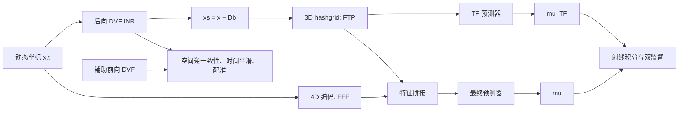

# BIRD：从动态 CT 的欠定问题到可运行网络

## 阅读基准与一句话理解

这里解释的是 **2026 年期刊版 BIRD**：Du et al., *Nonperiodic dynamic CT reconstruction using backward-warping implicit neural representation with diffeomorphism regularization*, PMB 71, 105003，[DOI](https://doi.org/10.1088/1361-6560/ae639c)。已通读本地 PDF 正文、图表、讨论、参考文献，并视觉核验网络图1、损失图2、编码图3；没有获得额外的独立补充材料。PDF 多一页封面，因此 PDF 文件页码比印刷页码大1。来源与代码检索见 [SOURCES.md](SOURCES.md)。

**BIRD 用一个可查询的连续时空函数表示当前扫描：共享参考结构经过后向形变，提供主要的解剖和运动信息；另一条自由时空特征补充单纯形变不能解释的变化。网络只靠本次扫描的投影训练，辅助前向形变和三个正则项帮助限制不合理运动。**

它是逐病例自监督重建，不是用大量患者训练后一次推理的 U-Net。输入是射线位置、扫描时间和实测投影，输出是任意指定时刻的三维衰减系数。连续时间可查询，不等于任意高频的真实运动都已被数据唯一确定。

**不需要输入先验图像。** 这里的“参考图像/参考空间”是优化中学到的潜在表示，并非要求另扫一张静态CT或先做一张FDK图。网络结构与正则本身含有时空先验假设，这与输入患者先验图像是两件事。用户猪心实验的相位CT只用于生成模拟投影；训练与GT评价分开。TIGRE及10秒扫描的具体适配见 [PIG_CBCT_SPEC.md](PIG_CBCT_SPEC.md)。

## 1. 作者面对的具体失败是什么

动态扫描中，每个视角在不同的时间拍到物体。某一瞬间只有很少角度，单独重建就严重欠定；把更多角度并进来，又会把不同时间的心脏状态混在一起。ECG 分期可在一定条件下组合多个周期的数据，但跨周期不一致会破坏这一办法。

BIRD 的关键判断是：虽然每个时刻观测不足，多个时刻仍共享大量解剖结构。重建应共同估计这些结构和运动，而不能把每个时刻当成独立图像。作者同时不把所有动态变化强行归因于形变，因为造影剂变化、结构分裂/合并或原始影像伪影都可能违反这一假设。

这能解释三项设计的来由：后向形变解决坐标查询成本；双特征降低纯形变模型的表达偏差；逆一致性正则抑制高表达能力 DVF 在欠定问题中产生的非解剖形变。这里是对论文设计逻辑的重构，不是对作者真实实验时间线或未公开动机的断言。

## 2. 从测量到训练：优化目标在哪里

位置 $\mathbf x\in\mathbb R^3$，时间 $t\in\mathbb R$，衰减系数 $\mu(\mathbf x,t)$ 为标量，单位 $\mathrm{mm}^{-1}$。对视角 $v$、探测器单元 $u$，post-log 投影为（式1）：

$$
p_{u,v}=\int_{l_{u,v}}\mu(\mathbf x,t_v)\,\mathrm dl.
$$

微例：一条射线经过三段各 1 mm 的组织，衰减系数为 0.01、0.02、0.03 $\mathrm{mm}^{-1}$，预测投影是 $0.01+0.02+0.03=0.06$。若观测为 0.07，这条射线还有 0.01 的误差；误差不能直接告诉你三个位置中的哪一个错了，需要其他角度和时空先验共同约束。

INR 把未知的体素数组换成坐标函数：$\hat f(\mathbf z)=\phi(e(\mathbf z))$。$e$ 将坐标编码成特征，$\phi$ 用小 MLP 输出图像标量或三维位移。每次迭代抽样射线，沿射线查询坐标函数、积分成预测投影，再比较实测投影并反传。没有 CT 真值和 DVF 真值参与本方法的训练损失。

## 3. 后向形变为何重要：先问“这个动态点来自哪里”

前向场 $D_f=D_{s\to d}$ 把参考点搬到动态位置：

$$
\mathbf x_d=\mathbf x_s+D_f(\mathbf x_s,t).
$$

后向场 $D_b=D_{d\to s}$ 直接回答动态采样点对应的参考位置（式8）：

$$
\mathbf x_s=\mathbf x_d+D_b(\mathbf x_d,t).
$$

假设某组织从参考坐标 $x_s=0.4$ 移到 $x_d=0.5$。前向位移是 +0.1；要查询动态点 0.5 的图像值，后向网络直接给出 −0.1，得到参考坐标 0.4。注意：一般空间变化的场不能用 $D_b(x)=-D_f(x)$ 代替真正的逆映射，因为两个场求值的坐标不同。

在论文讨论的常规前向网格实现中，不能直接反解动态点的静态来源，往往需要求整个参考网格和形变再插值。后向参数化能直接查询射线上所需点：每批 M 条射线、每条 N 个点约为 $O(MN)$ 次坐标查询。论文前向方案的 $O(MN^3)$ 中 M 是视角数，二者的 batch 含义不同；不能把它们当作相同测量数量下的实测倍数，也不能泛化为所有前向形变算法的必然下界。

## 4. 双特征：共享结构与自由变化怎样结合

图1、式10–14规定：

$$
F_{TP}=e_{TP}(\mathbf x_s),\qquad
\hat\mu_{TP}=\phi_{TP}(F_{TP}),
$$

$$
F_{FF}=e_{FF}(\mathbf x_d,t),\qquad
\hat\mu=\phi_\mu([F_{TP},F_{FF}]).
$$

TP 表示 topology-preserving，FF 表示 free-form。TP 特征从同一个参考空间抽取，再由运动重采样；FF 直接查询动态四维坐标。**融合发生在特征层，不是把两张图简单相加。** 最终结果是 $\hat\mu$；$\hat\mu_{TP}$ 是有独立投影监督的中间输出。

微例：参考组织衰减为 0.020，平移只改变位置，TP 可解释这种运动；若该组织因为造影剂增强变成 0.025，纯平移不能改变值。FF 可向最终预测器提供增强信息。这里 0.005 只是解释额外变化的例子，网络并没有被规定输出一个值为 0.005 的 residual 图，也没有保证两类特征存在唯一可辨识分解。

前向 DVF 是训练辅助网络，生成最终图像不需要调用它。参考图像是模型共同学习的潜在参考，不应无依据地指定为第0相位。

## 5. 为什么必须监督中间输出

将两路图像分别投影得到 $\hat p_{TP}$、$\hat p$，式15为：

$$
L_{FDL}=\lambda_{TP}\rho(\hat p_{TP},p)+(1-\lambda_{TP})\rho(\hat p,p).
$$

微例：两路误差为 0.04 和 0.01，$\lambda_{TP}=0.75$，则损失为 $0.75\times0.04+0.25\times0.01=0.0325$。此时即使最终头已经拟合得较好，模型仍被要求改善由参考结构与运动产生的结果。

若只监督最终输出，FF 分支可以补偿错误的运动，使 TP/DVF 不必正确承担其作用。论文图10的 C 与 E 对比支持双监督的重要性：单监督版本在两个数据集均有较多残余伪影。它支持模型设计的经验效果，但没有证明 TP 与 FF 达成严格的物理解耦。

作者推荐一般情况下 $\lambda_{TP}=0.5$；XCAT 以形变为主时为 0.75；含较多自由变化的临床模拟为 0.1。不是所有数据集共用一个最优权重。

## 6. 频域距离：排序和复数相位都不能丢

式16先按视角、探测器编号排序抽样射线，再做完整一维 DFT：

$$
\rho(\hat p,p)=\frac1m\left\|\operatorname{DFT}(\operatorname{Sort}(\hat p))-
\operatorname{DFT}(\operatorname{Sort}(p))\right\|_1.
$$

微例：预测 $[1,0,0,0]$，观测 $[0,1,0,0]$。DFT 分别为 $[1,1,1,1]$ 和 $[1,-i,-1,i]$，误差模长是 $[0,\sqrt2,2,\sqrt2]$，所以 $\rho=(2+2\sqrt2)/4\approx1.2071$。两者的频谱幅度却完全相同；若只比较幅度，会错误得到0。

这里对稀疏抽样后排序的序列做 DFT，并不是对完整 sinogram 做物理二维傅里叶变换。随机 batch 顺序会改变该损失，故两条投影分支和实测数据必须用同一排序键。论文解释它有利于不同频率的学习，但正文没有单独控制这一距离与 L1/L2 的消融，不能把该解释当作已经单独证实的加速机制。

## 7. 三项运动约束各管什么

### 7.1 空间项约束的是 cycle 误差的梯度

从静态点出发做一次往返（式19）：

$$
\hat{\mathbf x}_s=\mathbf x_s+D_f(\mathbf x_s,t)+D_b(\mathbf x_s+D_f(\mathbf x_s,t),t).
$$

设 $E=\hat{\mathbf x}_s-\mathbf x_s$，式20约束：

$$
L_{DM}^{REG}=\|\nabla_{\mathbf x_s}E\|_F^2.
$$

Jacobian 是 3×3 矩阵。它惩罚往返误差对位置的变化，不是直接惩罚位移大小，也不是普通 $\|\nabla D\|^2$。

一维手算：前向映射 $f(x)=1.2x$，后向映射 $b(y)=y/1.2$，复合 $b(f(x))=x$，所以 $E'=0$。若后向错误地取恒等映射，$E=0.2x$，$E'=0.2$，损失为0.04；在三个独立同样缩放的轴上为0.12。再看反例：若 $E(x)=0.1$ 恒定，梯度仍为0，损失不感知这个全局偏移。因此它是软近似正则，不能单凭此式保证严格逆映射、全局双射或 Jacobian determinant 始终为正。

代码用中心差分对每个空间轴求导，再对9个元素平方求和、对点取平均。两方向 DVF 都接收该项梯度。

### 7.2 时间项只约束前向 DVF

式21为：

$$
L_{TS}^{REG}=\left\|\partial_t^2D_f(\mathbf x_s,t)\right\|_F^2.
$$

固定参考点对应固定组织，随时间的前向轨迹应连续；固定动态空间位置在不同时间可能被不同组织经过，后向场可以快速变化。这就是作者只正则前向场的原因。

微例：一维 $D_f(t)=t^2$，取 $t=0.5,h=0.1$，二阶差分为 $(0.36-2\times0.25+0.16)/0.01=2$，平方为4；线性匀速运动的二阶差分为0。不能把它误写成一阶速度惩罚。

图11中，给后向场加时间平滑（B）效果差于无正则（A），双方向时间平滑（D）也差于仅前向（E）。这是对方向选择的直接消融依据。时间平滑仍可能过度约束快速心脏运动，作者在讨论中也承认这一点。

### 7.3 配准项给辅助前向 DVF 提供有效监督

前向 DVF 不在图像投影主通路上，需要额外学习信号。式22把动态点往返映射，比较 TP 图像内容：

$$
\mathbf x_s=\mathbf x_d+D_b(\mathbf x_d,t),\quad
\hat{\mathbf x}_d=\mathbf x_s+D_f(\mathbf x_s,t),
$$

$$
L_{RGT}=|\hat\mu_{TP}(\hat{\mathbf x}_d,t)-\hat\mu_{TP}(\mathbf x_d,t)|.
$$

微例：局部 TP 图像 $\mu_{TP}(x)=2x$，原点0.4，回到0.43，则内容误差 $|0.86-0.80|=0.06$。若回到0.4则为0。平坦图像区域无法提供同样强的配准约束，这也是图像一致性不能等同于真实运动标签的原因。

**此项只更新前向 DVF。** 后向 DVF 和 TP 图像参数冻结，原始目标值停止梯度；但第二次图像查询对回到的坐标必须可微。把整段放入 `torch.no_grad()` 会切断前向 DVF 所需梯度，是复现中很容易犯的错误。

### 7.4 总损失及训练归属

$$
L=L_{FDL}+10L_{DM}^{REG}+0.1L_{TS}^{REG}+10L_{RGT}.
$$

| 损失 | backward DVF | forward DVF | TP 编码/头 | FF 编码/最终头 |
|---|---|---|---|---|
| 双投影监督 | 更新 | 不更新 | 更新 | 更新 |
| 空间 cycle Jacobian | 更新 | 更新 | 不更新 | 不更新 |
| 时间二阶平滑 | 不更新 | 更新 | 不更新 | 不更新 |
| 配准 | 冻结 | 更新 | 冻结参数、保留坐标导数 | 不参与 |

## 8. 编码器和预测器如何写成代码

3D 编码器采用多分辨率 hashgrid。在每一级，把坐标落到网格单元，对周围顶点存储的特征插值，再拼接各级特征。原文用16级、每级2维，得到32维输出；每级表的最大容量为 $2^{19}$，base resolution=16。

一维插值微例：网格间距0.5，节点0和0.5的特征分别为0和2；输入0.125在区间中处于1/4位置，插值特征为 $0.75\times0+0.25\times2=0.5$。3D 对8个角点做相同的多线性插值；hash collision 会让不同顶点共享参数，多级组合缓解信息冲突。

4D 编码器不直接造一张4D网格，而是图3、式24–26的结构：

$$
h_x=\phi_{\gamma_x}(\gamma_x(x)),\quad h_t=\phi_{\gamma_t}(\gamma_t(t)),
$$

$$
e(x,t)=\phi_{4D}([\phi_x(h_x),\phi_t(h_t),\phi_{xt}(h_x\odot h_t)]).
$$

例如 $h_x=[1,2]$、$h_t=[3,4]$，交互为 $[3,8]$；若暂以恒等函数说明三支路，则送入融合的是 $[1,2,3,4,3,8]$。真实模型中每条支路都是可学习 MLP，不能用这个玩具恒等函数替代。

预测器按式23：$\phi(z)=\phi_2([z,\phi_1(z)])$，两个 $\phi$ 均为单隐藏层 MLP。这是 concatenate shortcut，不是 residual add。论文明确隐藏宽度32，但没有完整给出各中间输出维数、激活和初始化；本实现的补全见 [SPEC.md](SPEC.md)，均可审计。

## 9. 哪些部件有证据支持，哪些仍不确定

| 设计 | 原文证据 | 能支持的判断 |
|---|---|---|
| TP+FF | 图10 A/B/E | 纯形变约束对 XCAT 有价值；复杂临床模拟需额外自由变化 |
| TP 中间监督 | 图10 C/E | 减少当前实验中的残余运动伪影 |
| 空间正则 | 图11 A/C | 是减少不规则形变的重要组成；C仍含配准项，不能把全部收益单独归给空间项 |
| 仅前向时间平滑 | 图11 B/D/E | 支持方向选择，不能推导所有运动均满足均匀平滑先验 |
| 后向参数化 | §2.1.3 复杂度分析 | 支持按射线查询的计算优势；没有独立等预算前/后向速度实测消融 |
| 频域距离和三路编码 | §2.2.1、§2.3 | 有明确设计公式；没有分别隔离所有分支收益的消融 |
| 配准项本身 | §2.2.2 | 解释其训练用途；图11没有独立“只去掉配准”对照 |

期刊表1的困难 XCAT 设置是120 bpm、0.5 s/圈、540视角、384×384×320体数据。BIRD 全局 PSNR为31.99 dB，次优为31.74 dB；RCA为31.77对30.34 dB，差1.43 dB；RV差1.21 dB。收益更集中在小的心脏 ROI，而非全体积平均。

表1均值±标准差来自10个相位，表2来自20个相位，并不等于多随机种子的重复试验，也不是独立患者置信区间。临床模拟以既有20相位影像经配准和插值生成2500帧，包含原始相位伪影与插值影响；其自由变化不等价于已用纯净真值验证真实造影剂动力学。真实投影验证包括一个动态体模数据集和一个回顾性患者数据集，真实患者没有动态解剖真值。

比较中的 Unregularized INR 和 B-spline INR 在作者的统一后向框架中实现；它们代表建模策略，不能当成所有引用方法的官方实现直接复现。论文报告 RTX3090 上 XCAT 优化约6小时、临床模拟约8小时，64000次迭代；本 CPU 参考实现不承诺同样性能。没有低剂量/光子饥饿验证，也没有公开临床泛化证明。

## 10. 复现结果应该怎样命名

这份实现覆盖期刊版核心网络、物理投影和训练目标，称为“论文方法的独立参考复现”。`configs/paper.json` 保存原文公开的设置与显式补全；`configs/smoke.json` 明显缩小容量和采样，只用于流程验证。

数学测试和合成训练能验证公式实现、梯度、数据路径、恢复和推理；不能证明已经恢复真实解剖或达到论文表格数值。尚需作者的实际数据、几何、缺失超参数、预处理和评价范围，才能进入严格结果复现。代码入口、运行命令和实际验证记录分别见 [README.md](README.md)、[VALIDATION.md](VALIDATION.md)。
