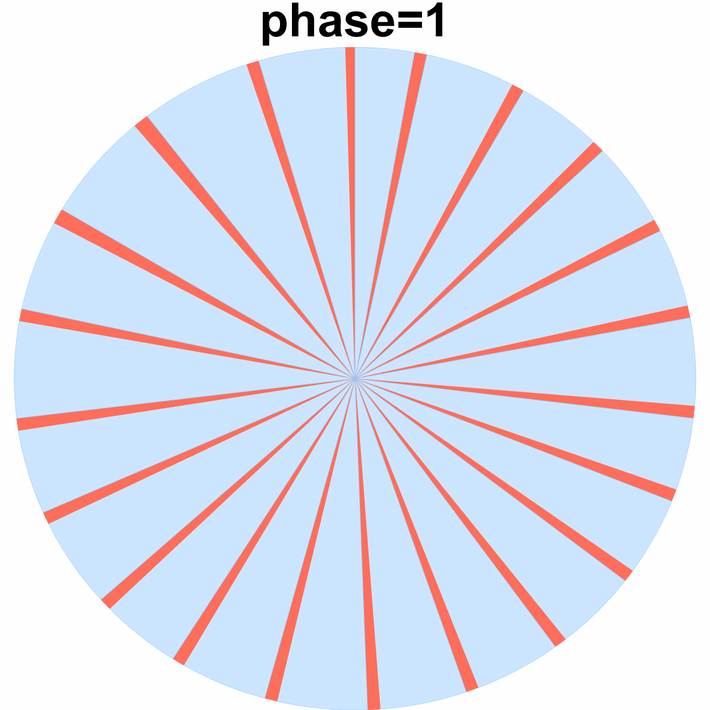
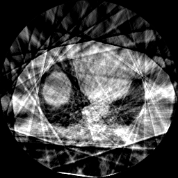
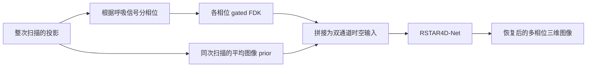

# RSTAR4D：从旋转条纹伪影到可分离 4D 网络

本 README 主要介绍论文 **RSTAR4D: Rotational Streak Artifact Reduction in 4D CBCT Using Separable 4D Convolutions** 的方法论：作者观察到了什么、为什么选择 4D 网络，以及如何在有限显存和少量病例下完成训练。复现与猪数据适配在文末简述，运行命令见 [README-training.md](README-training.md)。

阅读依据为仓库所用的 **arXiv v4（2024-09-29）** 全文及图表；公开代码用于核对实现细节。论文与公开代码存在部分训练设置差异，文中分别注明。

[论文原文](https://arxiv.org/abs/2403.16361v4) · [作者公开代码与动态演示](https://github.com/ZihengD/RSTAR) · [本仓训练说明](README-training.md)

## 1. 论文解决什么问题？

4D CBCT 希望在一次扫描中恢复不同呼吸相位的三维图像。一组数据可以表示为：

$$
F=\{f_1,f_2,\ldots,f_T\},\qquad f_t\in\mathbb{R}^{Z\times Y\times X}.
$$

这里，$X,Y,Z$ 是三个空间维度，$T$ 是呼吸相位数。论文通常使用 10 个相位。时间维表示**经过呼吸分箱后的相位顺序**，并不是把扫描期间每个时刻都恢复为一帧。

问题来自呼吸分箱带来的取舍：

| 重建方式 | 使用的投影 | 主要表现 |
|---|---|---|
| 全部投影重建平均图像 | 整次扫描的投影 | 角度覆盖较充分，但运动器官出现模糊 |
| 按相位进行 gated FDK 重建 | 只使用属于当前相位的投影 | 呼吸位置更明确，但投影稀疏且不均匀，产生严重条纹 |

例如，680 个视角分到 10 个相位，平均每相位约 68 个视角。实际问题不仅是数量减少：这些视角还会聚成若干角度簇，中间存在较大的缺失区间。因此，不能把它简单理解成“均匀降低采样率”。

论文的目标是：**从存在条纹的相位分辨图像中恢复结构，同时保留器官随呼吸变化的位置和幅度。** 方法作用于 FDK 后的图像域，输入是重建图像序列，输出也是图像序列。依据：[§2.1，图1–2](https://arxiv.org/pdf/2403.16361v4#page=5)。

## 2. 核心观察：条纹也有自己的“运动模式”

### 2.1 为什么条纹会随相位发生旋转？

扫描机架持续转动，呼吸又具有近似周期性。随着呼吸相位改变，选中的投影视角簇沿扫描角度移动，采样与缺失视角之间的边界也随之改变。重建条纹的方向与这些采样不连续位置相关，于是不同相位的条纹呈现出有规律的方向变化。

作者把这种现象称为 **Rotational Streak Artifacts，RSA，旋转条纹伪影**。

| 相位变化时的投影采样模式 | 对应的条纹变化 |
|---|---|
|  |  |

上面的动画来自作者公开仓库。“旋转”描述的是伪影模式随相位变化，并不表示人体组织真的发生了同样的旋转，也不意味着所有条纹都遵循一个精确刚体旋转模型。

### 2.2 这个观察为什么能指导网络设计？

论文认为，真实呼吸运动与 RSA 在时空中的表现存在差异：

- **真实呼吸运动**主要由膈肌驱动，在研究中的胸部数据上具有明显的 z 方向分量；轴位平面内更多表现为扩张、收缩等变化。
- **RSA**与采样方向变化有关，其表观运动在 x-y 平面内更明显，并随呼吸相位呈现旋转趋势。

在单张轴位图上，一条高亮细线可能是血管，也可能是条纹。观察其他相位和相邻切片，网络就有更多线索判断它是否符合解剖结构的连续变化。

作者使用光流、特征轨迹和 t-SNE 展示这种差异，作为构建时空网络的依据。**这些工具属于论文的分析实验，不是 RSTAR4D-Net 推理时需要执行的模块。** 网络本身也不要求先估计光流或显式配准各相位。依据：[§2.1，图3](https://arxiv.org/pdf/2403.16361v4#page=7)。

## 3. 整体流程：先分相位重建，再联合恢复整组图像

设 $\Omega_t$ 是分配给相位 $t$ 的视角集合，$p_{\Omega_t}$ 是对应投影，首先得到：

$$
f_t=\operatorname{FDK}(p_{\Omega_t}).
$$

例如，若相位 1 被分配了 60 个视角，其 $f_1$ 就由这 60 个视角重建；其他相位按各自的视角集合独立重建。随后，网络**联合处理所有相位**，利用相位间及层间相关性完成恢复。

### 论文需要先验图像吗？

**论文实验中的 RSTAR4D-Net 使用平均图像作为附加输入。** §2.3.4 明确说明，将平均图像与退化的相位图像拼接，形成网络输入。

这个 prior 来自**同一次扫描**，提供较稳定的整体结构信息；它可以存在运动模糊。它不是额外拍摄的高质量 CT，也不是训练标签 GT。

以本仓与公开网络采用的张量顺序表示：

$$
\text{input}\in\mathbb{R}^{B\times2\times T\times Z\times Y\times X},
\qquad
\text{output}\in\mathbb{R}^{B\times1\times T\times Z\times Y\times X}.
$$

两个通道分别是相位 CBCT 和沿相位维重复的同一张 prior。例如，$T=10$ 时，10 个相位各有自己的 CBCT，但共享同一张平均图像。

平均图像能补充结构线索，却不能替代相位信息：如果网络过度依赖平均图像，可能把真实运动也平滑掉。论文对临床结果的讨论正关注肿瘤和膈肌位置是否得到保留。依据：[§2.3.4](https://arxiv.org/pdf/2403.16361v4#page=13)、[§3.2](https://arxiv.org/pdf/2403.16361v4#page=17)。

## 4. 可分离 4D 卷积：用较低成本利用四个维度

### 4.1 为什么不直接使用普通 4D 卷积？

RSTAR4D-Net 以 U-Net 为骨架，通过编码器、解码器和跳跃连接融合不同尺度的信息。关键改动是让特征提取同时覆盖 x、y、z 和呼吸相位 t。

但一个普通的 $3\times3\times3\times3$ 卷积核，在每对输入/输出通道之间需要 81 个空间及时间权重位置；二维 $3\times3$ 卷积只有 9 个。再加上整组 4D 特征图的存储，直接扩展网络会带来较高计算和显存开销。

### 4.2 拆成三个方向分支，再相加融合

论文将特征提取拆成：

| 分支 | 卷积范围，按 x-y-z-t 顺序表示 | 主要提供的信息 |
|---|---|---|
| x-y 分支 | $3\times3\times1\times1$ | 轴位平面内的结构和条纹 |
| z 分支 | $1\times1\times3\times1$ | 相邻切片的连续性和层间变化 |
| t 分支 | $1\times1\times1\times3$ | 相邻呼吸相位的动态变化 |

对特征张量 $U$，一组分支可以概括为：

$$
H=\mathcal{C}_{xy}(U)+\mathcal{C}_{z}(U)+\mathcal{C}_{t}(U).
$$

三个算子分别作用于对应方向，输出形状相同，然后逐元素相加。图4中的模块包含**连续两组这样的并行分支**，最后接 LeakyReLU；公开代码也按这一方式实现。它是具有方向结构的可学习模块，不是声称任意普通 4D 卷积都能无损地改写成这三个分支。

一个简化的参数量例子可以说明节省来自哪里。假设输入、输出通道数都为16，忽略偏置：

- 单个普通 4D 卷积：$81\times16\times16=20\,736$ 个权重。
- 一组可分离分支：$(9+3+3)\times16\times16=3\,840$ 个权重。
- 连续两组可分离分支：$2\times3\,840=7\,680$ 个权重，约为前者的 **37%**。

这个比例对应图4中相同通道宽度下的模块比较，不能直接当作整个网络的显存或运行时间比例。可分离结构还允许训练时单独停用 z 分支，这正是后面 Tetris 训练能够成立的结构基础。依据：[§2.2.1，图4](https://arxiv.org/pdf/2403.16361v4#page=9)。

### 4.3 时间维为什么使用 circular padding？

呼吸相位描述一个近似周期。最后一个相位与第一个相位在周期边界相邻，因此论文在 t 方向使用循环填充。

例如，一组五相位特征 `[1,2,3,4,5]`，左右各填充一个位置后成为 `[5,1,2,3,4,5,1]`。这样计算相位1的邻域时，可以同时看到相位5和相位2，而不是在边界补零。

这一选择对应论文的呼吸周期假设。对不闭合的时间序列或其他器官运动，是否沿用循环边界需要结合数据含义判断，不能仅因张量具有时间维就默认成立。

## 5. Tetris 训练：先学平面内动态，再补充层间信息

只降低卷积成本仍不够。医学数据通常只有几十位患者，直接把每位患者的一整组 4D 图像当作一个样本，训练样本数量很少；整幅 4D 训练又占用大量显存。

Tetris 利用可分离网络的结构，把训练组织为两个阶段。

### Stage I：使用 2D+T 数据学习旋转条纹

固定一个 z 位置，取该轴位切片在所有呼吸相位上的图像，形成一个 2D+T 样本。这一阶段：

1. 保留 x-y 分支和 t 分支。
2. 冻结并跳过 z 分支。
3. 通过逐层取样，让模型先学习轴位结构以及条纹随相位变化的规律。

因此，Stage I 仍然利用完整的相位信息，并不是把每张图独立送入普通 2D 网络。

论文训练集有200组模拟4D数据，每组90层。逐层形成2D+T样本后，得到 $200\times90=18\,000$ 个样本，每个样本仍包含10个相位。这增加了可训练的样本单元和数据吞吐量，但没有增加独立患者数量。

### Stage II：使用不同形状的 4D 块补充体积一致性

在 Stage I 权重的基础上，启用 z 分支，并联合优化整个网络。输入改为包含多个相邻切片的 4D 块。

论文中的三种块尺寸如下。这里统一按 **Z×Y×X×T** 排列，便于与本仓代码对应：

| 块尺寸 | 提供的上下文 |
|---|---|
| $16\times256\times256\times10$ | 较大轴位范围，较少切片 |
| $32\times144\times144\times10$ | 中等平面范围和深度 |
| $64\times128\times128\times10$ | 更长的 z 方向上下文 |

三种形状都保留全部10个相位。其设计在有限显存内兼顾平面范围和 z 方向范围，并通过不同位置、不同形状的裁块增加样本变化。Stage II 让网络进一步学习膈肌驱动的层间变化，改善重建结果在 z 方向上的连续性。

“Tetris”指这种使用不同形状数据块训练同一模型的组织方式，并不是推理时需要把不同模型的结果拼接起来。论文在推理时用一张24GB RTX3090处理整组 $256\times256\times90\times10$ 图像；这是该尺寸和硬件下的报告，不代表任意大小的4D数据都能整幅推理。依据：[§2.2.2，图5、表1](https://arxiv.org/pdf/2403.16361v4#page=10)。

## 6. 监督信号与实验设计

### 6.1 训练数据如何获得？

论文从高质量4D CT出发，结合呼吸信号模拟动态CBCT扫描。在每个投影视角，根据呼吸信号选择相应状态的CT体进行正投影，再按相位进行 gated FDK，构造用于学习的退化图像与参考图像对。

一次动态扫描的投影来自不同呼吸状态；并不是分别对每个状态完成一次完整扫描后，把所有结果都当成实际观测。

论文主要实验设置包括：

- 45位患者用于训练/验证，其中40位训练、5位验证；每位患者用5条呼吸信号生成模拟扫描。
- 每次模拟扫描为680个视角、360°，包含10个相位。
- 模拟测试使用另外11组高质量4D CT及未用于上述模拟的呼吸信号，以原始4D CT作为评价GT。
- 另有12次真实临床CBCT扫描，用于检验方法在真实采集数据上的表现。

依据：[§2.3.1–2.3.3](https://arxiv.org/pdf/2403.16361v4#page=11)。

### 6.2 论文使用什么训练目标？

论文 §2.3.5 报告 RSTAR4D-Net 使用逐像素 L1 损失。用 $\widehat F$ 表示预测，$F^\ast$ 表示参考图像，可以写成：

$$
\mathcal L_{L1}=\frac{1}{TZYX}\sum_{t,z,y,x}
\left|\widehat F_{t,z,y,x}-F^\ast_{t,z,y,x}\right|.
$$

例如，三个体素的预测为 `[1,2,4]`，参考为 `[1,3,2]`，则平均绝对误差为 $(0+1+2)/3=1$。这个目标直接约束恢复图像接近参考图像；网络中没有必须执行的投影一致性迭代。

原文报告 Adam、batch size=1、学习率从 $10^{-4}$ 降至 $10^{-5}$、30 epochs，未在该段明确拆分两个阶段各自的训练预算。公开Notebook中的损失和训练循环与这些设置不同，见文末的复现说明。

### 6.3 作者如何检验“去掉伪影但保留运动”？

有GT的模拟数据使用图像域SSIM和RMSE，分别评价整体、肺部和肿瘤ROI。真实临床数据没有对应的无伪影GT，因此作者结合两类证据：

- 观察不同相位下肿瘤、膈肌的位置及层间连续性。
- 根据呼吸信号把恢复图像重新投影，与实际采集的投影比较SSIM和NCC。

重投影是论文的**评价步骤**，不是上述L1训练目标的一部分。投影一致性能够提供补充证据，但不能单独证明每个局部解剖细节都正确。依据：[§2.3.5、§3.2，图8–9](https://arxiv.org/pdf/2403.16361v4#page=18)。

## 7. 哪些实验支持这套方法？

论文表3的消融结果最直接地说明了“时间信息”和“训练策略”的作用。以下是论文报告的均值，**不是本仓复现实验的结果**：

| 设置 | 肿瘤SSIM（%） | 肺部SSIM（%） |
|---|---:|---:|
| 2D模型 | 77.48 | 74.55 |
| 2D+T模型／Stage I | 80.91 | 77.73 |
| 直接训练4D模型，不采用Tetris | 68.20 | 67.02 |
| 4D模型，仅使用Stage II块训练 | 82.20 | 78.60 |
| 4D模型，完整Stage I＋Stage II | **84.33** | **80.74** |

这组实验支持的结论是：在该研究的数据与训练条件下，加入时间信息有帮助；直接增加网络维度并不足以获得更好结果；块训练和2D+T预训练共同改善了4D模型的训练效果。依据：[表3](https://arxiv.org/pdf/2403.16361v4#page=17)。

证据范围也需要保留：

- 光流与t-SNE展示的是两种运动模式的差异，没有给出对所有病例都成立的严格可分离性证明。
- 表3主要考察维度与Tetris训练，不能据此单独量化循环填充或prior各自的贡献。
- 论文为比较网络本体，省略了部分对比方法原框架中的运动补偿或迭代重建模块。因此结果对应文中的对比设置。
- 主要证据来自胸部呼吸运动；推广到猪心脏、其他运动轨迹或异常呼吸时，需要新的实验验证。

## 8. 本仓的复现思路与当前范围

本仓围绕上述核心机制实现完整工程：保留公开网络的方向分支、循环时间边界、双通道输入和Tetris阶段切换；使用TIGRE和用户的几何/校准流程生成猪数据；补齐配对导入、动物级划分、恢复训练、滑窗推理和评价。

需要明确的几处区别：

| 项目 | 论文／公开资料 | 本仓采用的设置 |
|---|---|---|
| 损失和训练预算 | 论文写L1、30epochs；公开Notebook采用L1＋0.1×(1−SSIM)、Stage I 60／Stage II 30epochs | 按用户要求，以公开代码为默认依据 |
| prior构造 | 论文描述同次扫描的平均图像；公开MATLAB按各相位视角数加权其FDK结果 | 默认遵循公开MATLAB；另提供全部混合视角一次FDK选项，不假定两者数值等价 |
| 数据及GT | 论文为胸部4D CT仿真，测试GT为原4D CT | 猪数据采用TIGRE，GT为单状态全配置视角FDK及约定的后处理 |
| 训练块与推理 | 论文报告的块尺寸与24GB整组推理 | 保留完整T，缩小空间块并提供16GB环境下的空间滑窗 |

截至2026-11-16，本仓已通过36项测试，两条数据入口均跑通小规模训练—推理—评价流程，且完成一个真实猪病例的数据生成和训练块参数更新。尚未完成全部真实动物的60/30epoch实验，因此这里交付的是核心方法与工程实现，不能把上述论文指标写成本仓已经达到的指标。

实现对应文件：[网络](rstar4d/models/model.py)、[TIGRE仿真](rstar4d/simulation/pipeline.py)、[两阶段训练](rstar4d/training/pipeline.py)。配置、命令及验证范围分别见 [运行说明](README-training.md)、[Spec](docs/superpowers/specs/2026-11-16-rstar4d-pig-tigre-training-design.md)、[验收报告](docs/reviews/2026-11-16-implementation-acceptance.md)。
