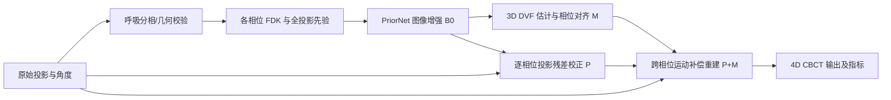

# prior-net：先验增强、运动补偿与投影约束的 4D CBCT 改造 Spec

状态：待评审  
日期：2026-11-03  
对象：当前仓库中的 PyTorch `prior-net`；目标任务为呼吸相位 4D CBCT 重建。

## 1. 目标与边界

目标是在现有的“稀疏相位图 + 全投影先验图 → 2D 增强图”基础上，形成可复现、可逐项验证的 4D CBCT 方法：先建立稳定基线，再分别验证投影约束和相位间运动补偿，最后组合两者。最终结果必须同时接受图像质量、时间一致性及测量投影的一致性检验。

本 Spec **不把心脏 CT 的短扫描角度、心率假设或数据集直接移植到呼吸 CBCT**。Yan 两篇论文提供配准训练与联合优化的机制参考；具体扫描几何和呼吸相位划分应以本项目数据为准。没有原始投影和扫描几何时，可以完成图像域阶段，但不能声称已实现投影约束或完整 PNMC。

本轮交付物是设计 Spec，不包含代码实现、实验结果或临床有效性结论。仓库目前没有附带可运行的数据清单、原始投影、权重或实验报告，所有性能判断均需后续实验验证。

### 1.1 非目标与不可接受结果

本阶段不开发新的呼吸信号提取算法，不把心脏短扫描参数当作本项目默认配置，也不以更换大型网络骨干作为首要任务。不可接受的结果包括：训练/验证病例交叉；验证时仍使用随机增强；在没有投影几何时宣称满足数据一致性；以视觉上更锐利但不符合测量投影的纹理作为改进；将 2D 位移场称作完整的 3D 呼吸运动模型。

### 1.2 考虑过的实现路径

| 路径 | 优点 | 代价与局限 | 选择 |
| --- | --- | --- | --- |
| 只增强当前 2D PriorNet | 最易落地，可快速做损失和架构消融 | 无法利用相位间信息，也无法检验最终结果是否符合测量投影 | 作为 B0/B1 对照，不作为最终方案 |
| 分阶段建立投影约束 P 与运动补偿 M，再组合 | 每个增益可以归因，便于发现形变、几何或图像增强哪一环出错 | 需要病例级 4D 数据、投影几何及更多实验 | **推荐路径**；延续上一轮讨论的代码改造方案 |
| 直接构建全链路联合训练 | 最终图像损失可同时调整各模块 | 数据、显存、可微投影和调试成本最高；缺少稳定基线时难以解释失败 | 留作阶段 E，可在分阶段结果成立后开展 |

## 2. 论文依据与正确对应关系

| 论文 | 可借鉴的方法 | 与当前代码的关系 | 不宜直接照搬之处 |
| --- | --- | --- | --- |
| [Hu 等，PRIOR：Prior-Regularized Iterative Optimization Reconstruction for 4D CBCT](../../../papers/PRIOR_Prior-Regularized_Iterative_Optimization_Reconstruction_For_4D_CBCT.pdf)，§III | 双编码器编码阶段拼接先验特征；用预训练网络修正迭代重建中的投影残差图；用 `FDK(y-Ax)` 维持数据一致性。 | **当前 `Dense2D` 最接近这篇的 PRIOR-Net 子网络**：编码阶段拼接、全局残差输出、MSE 训练；但没有 PRIOR 迭代框架。 | 论文在迭代中对残差与先验差值做尺度变换；现有网络截断负值并用 ReLU 输出，不能直接当作有符号残差校正器。 |
| [Ou 等，PNMC](../../../papers/Ou_2024_PNMC_prior_network_motion_compensation.pdf)，§2 | 从投影提取呼吸信号并分相；先验增强后估计 DVF；把 DVF 与测量投影用于运动补偿 OS-SART。PN-Net 使用不同的特征融合、non-local 模块和 `1-SSIM` 损失。 | 为“增强 → 配准 → 运动补偿迭代”的组合提供直接的呼吸 CBCT 参考。 | 不能把当前编码特征拼接和 MSE 训练称作已复现 PNMC 的 PN-Net。 |
| [Yan 等，2024：Motion-compensated 4DCT](../../../papers/Yan_2024_Motion_compensated_4DCT.pdf)，§2 | 先修正运动伪影，再由网络预测 DVF；以两相位参考图像的变形配准误差和 DVF 平滑项训练；之后做 FBP-and-warp。 | 为先训练增强网络、再训练配准网络提供可操作的图像域方案。 | 它针对单次心跳 CT；其角度范围、相位时长和后处理网络不是呼吸 CBCT 的默认参数。 |
| [Yan 等，2025：End-to-end 4D cardiac CT](../../../papers/Yan_2025_End_to_end_4D_cardiac_CT.pdf)，§2.3 | 通过可微空间变换和最终重建 MAE 联合优化图像修正网络及 DVF 网络，无需真实 DVF 标签。 | 为后期从分阶段训练升级到联合训练提供依据。 | 论文的“端到端”仍在预重建后的图像域；不能等同于从原始投影到图像的全链路可微重建。 |

因此，方案采用**可归因的分支实验**：`B0` 现有图像增强基线；`P` PRIOR 式投影约束；`M` PNMC/Yan 式运动补偿；`P+M` 组合。先证明每条分支有效，再考虑联合优化。

## 3. 仓库现状与必须先解决的问题

1. [`PriorNet_pytorch.py`](../../../PriorNet_pytorch.py) 的 `Dense2D` 是逐切片网络；`Dense2DPrior` 编码先验，五个尺度以 `torch.cat` 融合；输出为 `ReLU(x + residual)`。它没有 DVF、跨相位输入、投影算子和 PNMC 的 non-local 模块。
2. [`S3_Model_Training_wSimData_noUDA_wy.py`](../../../S3_Model_Training_wSimData_noUDA_wy.py) 只以 MSE 优化最终图像；SSIM 只在验证中计算。脚本导入仓库不存在的 `network_discriminator.py`，固定使用 CUDA、服务器绝对路径及每轮真实数据推理；还在每个 batch 写同一个 `predict.raw`。
3. [`S2_Prepare_Training_Data_XCAT_wy.py`](../../../S2_Prepare_Training_Data_XCAT_wy.py) 生成 `sim_train_XCAT.txt` / `sim_valid_XCAT.txt`，而训练脚本读取 `sim_train_v2.txt` / `sim_valid_v2.txt`。所谓 temporal 函数把路径字符串做三维切片，并反复覆盖同一个 `_all_phases.npz`，不能作为时序数据入口。
4. [`utils/read_2d_npz_wy.py`](../../../utils/read_2d_npz_wy.py) 在训练与验证中均随机缩放强度，且用 `path[:-1]` 去掉换行；验证结果因而不固定。负值裁剪、乘 50 与最终 ReLU 均应明确其物理强度含义，并记录从模型值到 HU/衰减系数的转换。
5. [`utils/tigre_demos.py`](../../../utils/tigre_demos.py) 有 TIGRE 几何构造示例，[`utils/spear_tools.py`](../../../utils/spear_tools.py) 有投影及角度读取函数，但当前训练样本 `.npz` 只包含 `input`、`label`、`prior`；没有统一的逐相位投影与几何数据契约，也没有投影算子集成训练。

上述是静态代码检查。Spec 的第一阶段要通过实际数据、依赖和设备运行验证，避免将“代码中未接入”误判为上游系统不存在。

## 4. 推荐架构

`BIN` 和初始 FDK 可继续由仓库外的既有流程提供，但其输出格式必须受第 5 节数据契约约束。优先保持 `Dense2D` 权重和行为可加载，所有新模块以独立类、独立训练入口接入。旧模型结果作为不可变的 `B0` 对照。

## 5. 数据与坐标契约

### 5.1 病例级数据

以 `case_id` 为分组单位建立 `train/valid/test` 清单，清单记录来源、相位数、体素间距、图像强度单位、扫描几何标识和可用模态。不得按切片随机拆分同一患者。每个病例至少提供：

- `sparse_volume[k]`：相位 `k` 的 FDK，形状 `[Z,H,W]`。
- `prior_volume`：全投影 FDK，形状 `[Z,H,W]`。
- `reference_volume[k]`：仅模拟/有监督评估时可用，形状 `[Z,H,W]`。
- `projections[k]`、`angles[k]`、`geometry`：投影阶段必需；投影形状约定 `[N_view,N_det_v,N_det_u]`，几何记录探测器、体素网格、源距、偏移及单位。
- `phase_index`、可选的呼吸信号/时间戳：保证原始视角与相位的对应关系可追踪。

图像和投影的轴顺序、角度单位、强度单位写入元数据；加载时验证每一相位的视角数、角度范围、图像尺寸和几何参数。大体积投影按病例分文件或采用可随机读取的分块格式，避免将所有病例重复存进逐切片 `.npz`。数据准备脚本仅产生病例级清单和必要的派生文件；训练时从病例级文件抽取切片或体块。

### 5.2 变形场语义

`warp(source, flow_target_to_source)` 在目标网格的每个坐标上采样源图像。DVF 张量约定 `[B,3,Z,H,W]`，三个通道对应物理坐标方向；单位为 mm，进入 `grid_sample` 前利用体素间距换算为归一化坐标。明确记录 `align_corners`、轴顺序及边界采样规则。若要把相位 `t` 对齐到相位 `k`，调用 `warp(I_t, flow_k_to_t)`。跨相位投影和反投影分别使用对应方向的形变；不能把逆形变直接当作变形算子的数学伴随。

### 5.3 验证集规则

验证/测试禁用随机强度缩放；相同病例和权重重复评估应得到相同指标。训练增强仅对 `input`、`prior`、`label` 施加一致的几何/强度变换，投影阶段还须保证同步更新角度和几何。训练、验证、测试清单及预处理版本随检查点保存。

## 6. 模块设计与代码改动

### 阶段 A：基线可复现

改造现有三个脚本，不改变 `Dense2D` 的核心结构与旧权重命名。以配置文件/命令行参数替代硬编码路径、设备、batch size、优化器及评估频率。清理缺失模块导入；在 CUDA、CPU 之间显式选择设备；断点恢复验证网络、优化器和配置匹配。验证函数同时计算 MSE、RMSE、SSIM、PSNR，并以病例和相位为聚合单位。真实数据推理作为单独命令，不放在每个 epoch 的必经路径中。保留原始强度版本的 B0 结果，作为后续所有消融的对照。

建议新增 `configs/baseline.yaml`、`datasets/manifest.py`、`datasets/phase_dataset.py`、`evaluate.py`；旧数据读取器可保留作兼容入口。检查点记录归一化、数据清单哈希及代码版本信息。此阶段完成条件是：从数据准备、训练到固定验证均可运行，且同一检查点重复评估数值一致。

### 阶段 B：网络结构与损失消融

以配置开关分别实现 `MSE`、`MSE + α(1-SSIM)`、边缘保真项；所有权重在训练前配置，按验证集选择，不能看测试集调参。进一步独立实验 `concat` 与可学习门控的先验融合，以及 PNMC 式 non-local 模块。这里的门控是本项目提案：先验图在运动边界可能模糊，网络应能降低局部先验权重；它不是四篇论文中已直接证明有效的模块。每次只改变一个因素，并记录计算量、显存和推理耗时。

若选择 PNMC 式网络对照，明确命名为 `PNNetVariant`，不要覆盖 `Dense2D`；PNMC 的特征融合、注意力和 `1-SSIM` 必须整体或逐项标记，不能把局部改动称为完整复现。

### 阶段 P：PRIOR 式投影约束分支

新增 `physics/geometry.py`、`physics/projector.py`、`reconstruction/prior_iterative.py`。算子接口至少包括 `forward_project(volume, phase_geometry)`、`backproject(projection_residual, phase_geometry)` 和 FDK；先在单相位模拟数据上核对正反投影维度、单位和投影残差，再扩展到十相位。原型可用 TIGRE 实现，但不能仅凭 [`utils/tigre_demos.py`](../../../utils/tigre_demos.py) 的几何构造函数声称已有完整算子。

PRIOR 论文的校正思路为 `g_k = FDK(y_k - A_k x_k)`，并以 `m_k = x_k - PI` 表达与全投影先验的差异，然后更新 `x_k`。实现时新增**有符号校正头** `CorrectionNet(g_k,m_k) -> Δx_k`，使用线性输出；`x_k^{n+1} = clamp_nonnegative(x_k^n + α_n Δx_k)`。这个头可复用 `Dense2D` 的编码器结构，但不能原样复用其 `ReLU(result+x)` 输出，也不能继续把负校正量裁剪掉。论文的尺度变换 `ξ` 要由配置明确记录；若采用本项目的残差监督训练而非原论文输入变换与公式，实验名称应写“PRIOR-inspired”，不可写“PRIOR 复现”。

先把校正网络固定，测试投影残差是否随迭代整体下降、是否生成假纹理；之后再评估是否反向传播穿过展开迭代。此分支不依赖 DVF，可以单独与 B0 比较。

### 阶段 M：相位间运动补偿分支

新增 `datasets/temporal_volume_dataset.py`、`models/motion_net.py`、`motion/warp.py`、`train_motion.py`。修复或替换现有 temporal 函数，按病例读取完整相位体积；为目标相位 `k` 选相邻相位窗口，呼吸周期边界是否循环连接由数据时间戳及相位定义决定，不默认套用心脏论文的循环填充。

第一版对每相位仍用现有 `Dense2D` 按切片增强，然后用低分辨率 **3D MotionNet** 预测 `flow_k_to_t`。3D 是目标实现，因为呼吸运动包含层间分量；纯 2D DVF 仅允许作接口原型，不能作为完整 3D 运动补偿结论。图像域初步融合可写作 `I_k^MC = Σ_t w_{k,t} warp(E_t,flow_k_to_t) / Σ_t w_{k,t}`，其中 `E_t` 为增强图，权重先用固定时间距离/质量规则，学习权重作为后续消融。

参考 Yan 2024，分阶段训练使用参考相位图像的双向变形误差、DVF 一阶梯度平滑项及可选逆一致性项；无需真实 DVF 标签。对无参考图的临床数据，可以报告图像域相似度、投影残差和可用的解剖标志点，但不能将相似度单独解释为真实运动精度。应监控 Jacobian 非正比例，避免形变折叠。

### 阶段 P+M：运动补偿投影重建

组合阶段使用所有可用相位的投影。对于目标相位 `k` 的当前图像 `x_k`，通过相位间形变得到相位 `t` 的预测体积，再以 `A_t` 与实测 `y_t` 比较。误差回传到目标相位时须使用与实际 warp 约定一致的反传/伴随算子；先以小体模数值校验，再实现 OS-SART 式迭代。记录各相位投影残差、图像指标、迭代曲线和运行成本。

若没有可靠的双向 DVF 或投影几何，这一阶段暂停在独立的 P、M 结果，不用图像域融合结果冒充 PNMC 的运动补偿 OS-SART。PNMC 提供组合思想，PRIOR 提供无运动的投影残差校正基线；两者应分别作为消融对照。

### 阶段 E：可选的联合优化

仅在分阶段 P、M、P+M 都稳定后进行。参考 Yan 2025，让最终相位重建损失对增强网络和 MotionNet 联合反传；损失可写为 `L = λ_img L_ref + λ_proj L_proj + λ_reg L_reg + λ_smooth L_DVF`。无参考临床数据不能启用 `L_ref`，各项须独立记录。若 TIGRE 路径不可微，先联合训练纯图像域增强、DVF 和 warp；要声称投影到图像的全链路联合训练，必须换用经过验证的可微投影/反投影算子。避免把后处理梯度误称为整个物理链路端到端。

## 7. 实验矩阵与验收

| 实验 | 与 B0 的唯一主要区别 | 需要回答的问题 |
| --- | --- | --- |
| B0 | 现有 `Dense2D`，修复运行/评估流程 | 当前方法能否稳定复现？ |
| B1 | 损失、先验融合或注意力之一 | 图像增强真正受益于哪个改动？ |
| P | 投影残差迭代，无 DVF | 数据一致性能否补回细节，是否有伪纹理？ |
| M | 3D DVF + 相位对齐，无投影迭代 | 相邻相位能否带来真实时间分辨率提升？ |
| P+M | 运动补偿投影重建 | 两条分支结合是否优于各自单独使用？ |
| E | 最终损失联合优化 | 联合训练是否优于分阶段训练？ |

所有实验使用同一病例级拆分、相同几何/强度预处理和明确的训练预算。模拟数据报告逐病例及逐相位 RMSE、PSNR、SSIM，特别列出最大运动相位和运动边缘 ROI；临床数据报告可验证的投影残差、可用的标志点误差、形变折叠比例和盲审图像结果，不以全投影模糊图作为“真实相位标签”。同时报告训练/推理时间与显存，避免仅追逐单一图像指标。

代码验收至少覆盖：数据清单无病例交叉；固定验证重复结果一致；零 DVF 时 warp 等于输入；已知平移场的方向与 mm/voxel 换算正确；正反投影维度和单位一致；模拟投影残差校正的更新方向正确；有限输入下各阶段无 NaN/Inf。实验验收以同一测试集的病例级结果和消融表为准，不预设未经实验支持的提升幅度。

## 8. 关键风险与处理

1. **先验图的运动模糊被复制到动态边界。** 保留输入残差路径，单独测量运动 ROI；门控融合需用消融证明有效。
2. **增强图像的假结构误导配准。** 对 DVF 加平滑与折叠监控；用参考相位图、标志点或投影一致性作外部核验。
3. **模拟到临床的域差异。** 先锁定模拟基线，再单独测试真实投影噪声、非均匀角度、不同设备几何；域适应是后续分支，不与核心方法同时改动。
4. **物理量与坐标约定不一致。** 在数据元信息中固定 HU/衰减系数、角度、探测器和 DVF 单位；以简单体模做数值检验。
5. **3D 配准和展开重建显存过高。** 从低分辨率体积、固定增强网络和少量迭代开始；记录开销，再决定是否使用体块、混合精度或梯度检查点。

## 9. 决策与待补充输入

推荐路线为：A 基线 → B 单因素消融；同时准备 P 所需原始投影/几何与 M 所需病例级 4D 体数据；随后分别完成 P、M → P+M → 可选 E。P 与 M 可独立验证，组合前必须都有可信基线。

实施前需核实：现有数据中原始投影、角度和扫描几何的实际位置；`FullVol` 标签的生成方式及强度单位；病例命名是否足以保证患者级拆分；可用 GPU 显存和目标体积尺寸。若部分数据暂缺，先完成不依赖它们的 A/B/M 图像域工作，不以推测值填充投影几何。
