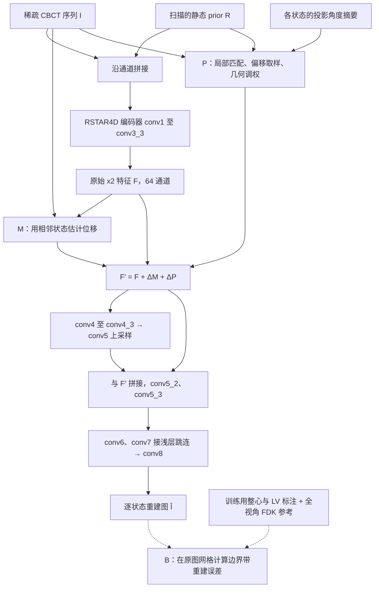

# RSTAR4D 猪心轮廓重建网络设计规格

2026-11-18 · v1.4 · 拟实施的网络设计。主干层名和尺寸已与当前代码核对；新增层的通道数、位移范围和损失权重为首版设计值，效果及显存开销待实验测量。

## 1. 完整模型怎样重建一个状态

每例扫描的全部相位均使用对应的全视角 FDK 参考图参与重建监督。人工 mask 中，1 表示心脏除左心室以外的部分，2 表示左心室（LV），LV 内有造影剂。首轮同时增强**整心外边界**和 **LV 标注边界**。边界监督 B 分别对两条可信表面附近的灰度重建误差加权，标注可用性由各扫描的实际文件和可信区域决定。

模型输入整条稀疏 CBCT 序列和该扫描的静态 prior，输出逐状态重建图。以状态 5 为例，**运动分支 M** 在状态 4、6 中估计对应的局部采样位置，将邻居特征拉回状态 5 的网格。**prior 分支 P** 在静态 prior 中寻找匹配结构，根据局部匹配和状态 5 的采样角度调节取用量。两者在 Stage II 的同一张中间特征图上提供修正，解码器将修正转成当前状态的图像细节。



实线是推理数据流，虚线是训练监督。每个状态在自己的网格输出一个强度通道。训练时人工 mask 用于选取边界带。评价时从留出动物的重建图独立分割或勾画整心与 LV，与各自人工表面对照。

## 2. 与现有 RSTAR4D 主干逐层结合

### 2.1 现有编码器和解码器

现有 Stage II 由空间下采样、时空残差块和带跳连的上采样构成。残差块内的 XY、Z、T 卷积沿各自维度处理特征并相加。T 分支在同一格点读取邻近状态；M 另提供先寻找对应位置再取样的路径。下表以一个 10 相位系列的 `[B,2,10,16,128,128]` 训练块为例。表中省略 batch 和状态维，空间轴按 Z/Y/X 排列。模型接口按输入确定 `T`。

| 顺序 | 代码中的层和操作 | 通道 × Z × Y × X | 传给谁 |
|---|---|---|---|
| 输入 | 每个状态的稀疏图与复制的静态 prior 拼成两通道 | 2 × 16 × 128 × 128 | 原 `conv1`；原输入也供 M、P 各自取图 |
| 编码 1 | `conv1` 在 Z 轴降采样，接 `conv1_2/3` 残差块 | 16 × 8 × 128 × 128 | `conv2` 和 `conv7` 的浅层跳连 |
| 编码 2 | `conv2` 在 XY 降采样，接 `conv2_2/3` | 32 × 8 × 64 × 64 | `conv3` 和 `conv6` 跳连 |
| **编码 3 / 接入点** | `conv3` 在 XY 降采样，`x2 = conv3_3(conv3_2(x2)) + x2` | **64 × 8 × 32 × 32** | 在这里计算 `F′`，同时供深层编码和同尺度跳连使用 |
| 编码 4 | `conv4(F′)` 在 XY 降采样，接 `conv4_2/3` | 128 × 8 × 16 × 16 | `conv5` |
| 解码 1 | `conv5` 上采样得 64 通道，与 **同一个 F′** 拼成 128 通道，`conv5_2/3` 与残差相加 | 64 × 8 × 32 × 32 | `conv6` |
| 解码 2 | `conv6` 上采样得 32 通道，与编码 2 拼成 64 通道，接 `conv6_2/3` | 32 × 8 × 64 × 64 | `conv7` |
| 解码 3 | `conv7` 上采样得 16 通道，与编码 1 拼成 32 通道，接 `conv7_2/3` | 16 × 8 × 128 × 128 | `conv8` |
| 输出 | `conv8` 恢复 Z 尺寸并映射到一个强度通道 | 1 × 16 × 128 × 128 | 预测 `[B,1,10,16,128,128]`，原图尺度计算损失 |

**为什么选第三层。** 示例中这层的 XY 采样间距为原图的 4 倍，第四层为 8 倍；心脏边界附近的匹配放在第三层能保留更细的位置线索。在该尺度做局部三维匹配的网格点数为输入的 1/32。增强结果经过深层路径形成上下文，也通过跳连在解码时直接供恢复边缘使用。前两层跳连继续提供接近原分辨率的细节。这个取点对应现有代码中相邻的两行及其下游拼接。[Stage II 编码与跳连](../../../rstar4d/models/official_stage2.py)

### 2.2 现有 forward 的改动范围

原始输入记为 `image`，与从 `conv1` 开始被反复赋值的特征变量区分。M 和 P 裸读各自所需的原图通道；保留原模型双通道输入可以复用第一层权重。下面是现有 `myUNet.forward` **编码 3 到解码 1** 的拟议接法，省略已经按原逻辑算出的 `x1` 和浅层跳连。两个分支的输入均取自修正前，合并只执行一次。

```python
# image: [B,2,T,Z,Y,X]，已按 forward_volume 原规则补齐
F = self.conv3(x1)
F = self.conv3_3(self.conv3_2(F)) + F
enhanced = F
aux = {}
if self.motion is not None:
    delta_m, aux = self.motion(image[:, :1], F, context, return_aux=return_aux)
    enhanced = enhanced + delta_m
if self.prior_fusion is not None:
    static_prior = image[:, 1:2, 0]  # [B,1,Z,Y,X]，同一扫描只编码一次
    delta_p = self.prior_fusion(image[:, :1], static_prior, context)
    enhanced = enhanced + delta_p

deep = self.conv4(enhanced)
deep = self.conv4_3(self.conv4_2(deep)) + deep
up = self.conv5(deep)
decoded = self.conv5_3(self.conv5_2(torch.cat([up, enhanced], dim=1))) + up
# decoded 接原 conv6 至 conv8。训练需要位移时连同 aux 返回。
```

原模型中 `forward_volume` 负责在输入末端补齐 Z 到偶数、XY 到 8 的倍数，并裁回输出。空间 context 与输入补到同一网格，补入的体素在有效域里置假。Stage I 使用原 XY+T 网络、原损失和已选的训练权重。Stage II 创建时先对原主干执行严格权重转移与 Z 卷积初始化，再挂载 M、P 并构建优化器。B 单开时只需从训练器接入损失。[模型构建、迁移及裁切](../../../rstar4d/models/model.py)

**为什么用两个残差直接相加。** M 的输出是「对齐后邻居与当前特征的差」，三个来源（当前、前状态、后状态）的权重在 M 内合计为 1。P 的输出是从静态图检索后投影出的 64 通道修正，局部匹配分数和采样点权重都小时修正趋近于零。两条路径都使用同一个 `F`，相加后 `conv4` 和 `conv5_2` 原有的输入通道数仍分别是 64 和 128。主干第一层本来就读 prior，所以 P 的门控描述的是**新增路径**取用了多少 prior 特征。可记录 `ΔM`、`ΔP` 相对 `F` 的均方根幅度，检查联合训练时某一路是否主导了输出。

## 3. 三项模块的内部设计

以下给出可直接实现的首版层配置。新增空间算子使用 PyTorch 的 `Conv3d`，隐藏层激活为 `LeakyReLU(0.2)`；3³ 卷积 padding=1，1³ 卷积 padding=0，未注明的 stride 为 1。空间编码器逐状态处理，先从 `[B,C,T,Z,Y,X]` 交换轴为 `[B,T,C,Z,Y,X]` 再展平为 `[B·T,C,Z,Y,X]`，算完还原轴序。定义特征网格 `S = (Z/2,Y/4,X/4)`，M 和 P 输出均为 `[B,64,T,*S]`。以下通道配置只规定新增模块。

**两分支共用的空间约定。** 从原图有效域按同一格点中心 `(2z,4y,4x)` 取得特征网格的有效位。对目标无效点强制 `ΔM=ΔP=0`。源的连续坐标可借用第 3.1 节所述中心块周围实际读取的上下文。所有非零三线性插值权重对应的格点须同时位于读取范围和源成像有效域（FOV）内。人工 padding 标为无效。M 按邻居、P 按采样点分别屏蔽失效项。坐标换算与有效域判断使用 FP32。

**距离单位。** 全文的 `vox` 表示全分辨率 FDK 输出网格上的一个体素步长。点和位移分量按 Z/Y/X 排列，可取小数。两点的距离为其索引坐标差的欧氏范数，三轴单位间距均取 1，例如轴向一步为 1 vox，沿两个轴各一步为 √2 vox。图像和标签先按采集几何对齐到同一输出网格，随后训练、滑窗与轮廓评价共用该索引度量。

### 3.1 M · 从相邻状态取对齐特征

**两份特征各有用途。** 动态图像描述 `E_t` 用来估计位移，只读稀疏 CBCT，可避开跨相位恒定的静态 prior。真正送往解码器的值取自主干 `F_t`；其中已经包含 baseline 的 prior 和时空上下文。位移估计与特征传输因而可以使用不同通道数。

| 顺序 | 输入 | 新增算子 | 输出及含义 |
|---|---|---|---|
| M1 描述当前解剖 | 每个状态的单通道稀疏图 `I_t` | 3³ Conv 1→8，stride (2,2,2)；3³ Conv 8→16，stride (1,2,2)，各接激活 | `E_t[16,*S]`；所有状态共享此编码器 |
| M2 预测位移 | `cat(E_t,E_s,abs(E_t−E_s))`，48 通道 | 3³ Conv 48→24→16，各接激活；1³ Conv 16→3，线性输出接 tanh | `u_vox[t→s,3,*S]`，三个分量按 Z/Y/X 给出目标格点到邻居采样点的偏移。建议初值每轴上限 8 vox，按验证集饱和率及视野内支撑调整 |
| M3 对齐邻居 | 邻居的 `F_s[64,*S]`、位移 `u_vox[t→s]` | 将输出网格体素位移按轴除以 `x2` 步长 `(2,4,4)` 得到特征格偏移，用三线性 `grid_sample` 从邻居拉回 | `A_s[64,*S]`，与目标 `F_t` 共用坐标 |
| M4 计算借用权重 | 将 `F_t`、`A_s` 经过同一个 1³ Conv 64→8 得 `h_t,h_s` | `cat(h_t,h_s,abs(h_t−h_s))` 为 24 通道；1³ Conv 24→8 + 激活，再接 1³ Conv 8→1。两个方向共享此头 | 每个邻居得到一个 logit；当前位置自身 logit 固定为 0，一起沿候选轴做 softmax |
| M5 返回修正 | 当前特征、有效邻居及其权重 | `ΔM_t = Σ_s a_s · (A_s − F_t)`，求和只含邻居 | `F_t+ΔM_t = a_self·F_t+Σ_s a_s·A_s`；其余分支始终读同一份原始 `F` |

按有序状态配对，每相邻两状态预测两个有向场，合计 `2(T−1)` 个。例如 10 相位系列有 9 对邻居、18 个有向场。两个方向复用一套权重，分别前向估计。M 在有序序列首尾各有一个显式邻居。没有有效源支撑的候选在 softmax 前屏蔽，只剩当前体素时令 `ΔM=0`。初始位移头用小幅权重和零偏置；邻居 logit 末层用零权重、偏置 −4，使双邻居都有效时当前状态初始权重约 0.965。训练后权重逐体素变化。

**单位和方向。** 位移头在 `x2` 网格预测 `u_vox = 8 × tanh(raw)`，三个分量各自以输出网格体素计。设 `s=(2,4,4)` 为 `x2` 在输出网格上的步长，目标特征坐标 `i` 对应的邻居采样位置为 `i + u_vox/s`（逐轴相除）。例如状态 5 的特征格点 `(4,12,10)` 若预测 `(0,0,+3)` vox，则读取状态 4 的 `(4,12,10.75)`。实现时将 Z/Y/X 顺序改为采样器需要的 X/Y/Z；`align_corners=False` 时长度 n 的轴上连续索引 i 的归一化位置为 `2(i+0.5)/n−1`。用于原图参考或表面点时，按扩展块全局原点及步长在场上插值，再将插值得到的 `u_vox` 直接加到输出网格坐标。上采样只改变场的采样密度，位移分量保持原值。

**Stage II 运动监督的裁块规则。** 采样器先选目标中心块 `C`，再从同一病例的全部状态和静态 prior 读取带上下文的扩展块 `W`。主干和分支均在 `W` 上提取特征。在输出网格坐标中，有向场将目标点 `x` 映射到源位置 `x+u_vox(x)`，允许它越过 `C` 到达邻居在 `W` 中的任何真实有效位置。训练用邻居参考描述和可选表面距离图也提供这段支撑。Stage II 的重建损失和 B 在 `C` 上计算，运动匹配只对中心位于 `C` 的合格窗口计分。八组共用中心块、扩展块和样本顺序。

扩展块各轴的单侧宽度取 `ceil(该轴位移上限 + LNCC 窗半径 + 采样支撑余量)`，三项均按输出网格体素计。余量覆盖梯度差分、插值和特征编码所需邻域。用特征格给出的支撑先乘该层对应轴步长。例如每轴位移上限 8 vox 时，Z 轴单侧由位移贡献的宽度为 8 层，在 `x2` 上相当于 4 格，另加窗口和支撑余量。扩展块起止向外对齐全幅 Stage II 的下采样网格（Z 为 2，XY 为 8），保存全局索引原点及 `C` 在 `W` 内的切片。在扫描边缘将读取范围截到真实体积，模型所需的额外 padding 沿用全幅规则并标为无效。

固定窗口集合前，检查在允许的位移范围内，所需且属于真实源 FOV 的支撑应已读入。缺少这部分数据属于裁块配置错误，报告病例、轴和所缺宽度并调整读取范围。只有实际越出源 FOV 的采样才触发第 4 节的空间越界代价。该检查独立于模型本次预测的位移。

### 3.2 P · 从静态 prior 寻找候选，用采样几何调权

P 面对的是跨状态混合得到的静态 prior，同一段心脏边界可能在其中呈双边缘。它先用图像回答每个体素“到哪里找”，再判断各候选值可以借多少。P 使用独立于 M 的编码器，P 内部的动态图和静态 prior 共享同一套空间编码权重，使二者处在相同描述空间。

| 顺序 | 输入 | 新增算子 | 输出及含义 |
|---|---|---|---|
| P1 动态与静态特征 | 各状态的 `I_t` 和单份 `R[B,1,Z,Y,X]` | 共用 M1 所列**层规格**，P 有自己的参数。对 prior 每个病例或空间块仅编码一次 | 动态 `C_t[16,*S]` 和静态 `C_p[16,*S]` |
| P2 局部粗匹配 | `C_t,C_p` | 两个独立 1³ Conv 16→8 得 Q、K，沿通道 L2 归一化。计算目标点与 prior 3×3×3 窗口内各有效候选的原始余弦相似度，选出最大者 `p*`。将有效候选分数除以温度 0.2 后做 softmax | 保留 `p*` 的两项数值：`r(x)` 为 softmax 前的有符号余弦相似度，范围 [−1,1]；`s_rel(x)` 为 softmax 后的候选间相对权重。另用 1³ Conv 16→16 得 prior 值特征 `V` |
| P3 微调取样位置 | `H=cat(C_t,C_p(p*),abs(C_t−C_p(p*)))`，48 通道 | 3³ Conv 48→16 + 激活，1³ Conv 16→21 后 tanh。21 通道拆成 7 个三维偏移，Z/Y/X 每轴微调上限分别为 `(2,4,4)` vox，对应本层各 1 个特征格 | 以 `p*` 为中心，加中心及 ±Z、±Y、±X 共 7 个固定核偏移，再加学习偏移 `δp_j`，三线性取到 `V_j[16,*S]` |
| P4 编码采样条件 | 每相位 14 维输入 | 12 个固定 30° 角度分箱的相位内比例 + 相位投影数/总数 + 扫描弧内最大相邻角间隔/360°；MLP 14→16 + 激活 →8 | `e_t[8]`，沿空间广播，同一病例的所有块共用同一相位的编码 |
| P5 逐点调权 | `cat(H,e_t,r(x))`，48+8+1=57 通道 | 1³ Conv 57→16 + 激活，1³ Conv 16→7，接 sigmoid | 7 个 `m_j(x)` 调节取用量。几何只进入此头。原始相似度让该头在有效候选很少时仍能区分匹配质量 |
| P6 回到主干 | `V_j`、候选有效位、`m_j` 及 `s_rel(x)` | 每个采样点有 16 维可学习逐通道系数 `w_j`，以 `1/7` 初始化。将 `s_rel(x)·Σ_j m_j·(w_j ⊙ V_j)` 经无偏置 1³ Conv 16→64 | 得到 `ΔP_t[64,*S]`，输出层用小幅非零权重初始化，以便 prior 路径从训练初期获得梯度 |

无有效粗候选时直接返回该体素的零修正。若只剩一个有效粗候选，无论匹配好坏都有 `s_rel=1`，此时 P5 仍可通过 `r(x)` 和局部图像特征降低取用量。微调后个别采样点越界时只屏蔽对应项。`p*` 经 argmax 确定，选中值 `r(x)` 和 `s_rel(x)` 保留计算图，细偏移通过三线性插值反传。局部索引和相似度按状态或空间块分批计算。二十七个候选是粗匹配的搜索范围，七个点是实际传输特征的采样核。

角度由 `angles_rad` 和 `state_label` 按实际 `phase_labels` 配对。各病例使用统一扫描坐标的零点和正方向；直方图覆盖 360°，未采扇区记零。计算相邻间隔时按扫描轨迹展开跨零角度，仅计算弧内间隔。纯图像对照沿用相同的 P1–P6，包括 `r(x)` 输入，只向几何 MLP 提供固定常量。同一相位共享 `e_t`，不同空间位置的局部特征、匹配得分和取用量仍可不同。

### 3.3 B · 在最终重建图上监督有标注边界

**从两张区域掩膜分别取表面。** 在完整 FDK 输出网格上，用 `H = (mask == 1) | (mask == 2)` 得到整心，提取它与已确认心外背景相邻的外表面。`V = (mask == 2)` 给出 LV 标注区域，提取其可信表面，包括 LV 与其余心脏组织之间的界面。该内部界面只属于 LV 表面。两种表面均剔除 FOV 截断、未标区域和不可信界面。整心外轮廓的可用性需单独确认，局部 LV 标注本身不足以还原完整整心。LV 的具体解剖范围以实际勾画为准。

对每种可信表面，先在完整输出网格上计算体素中心到该表面的最短欧氏距离（单位间距 `(1,1,1)`），再裁取中心块。对结构 `k ∈ {H,V}`，`Q_k` 为本 batch 中该结构已标相位里、落在 `C` 的有效成像及标注域、距其可信表面不超过 2 vox 的体素集合（表面两侧均取）。对最终重建强度 `pred = conv8(...)` 和同网格全视角参考计算

```text
A = {k in {H,V} with |Q_k| > 0}
L_k = mean_{x in Q_k} abs(pred[x] - reference[x])       # k in A
L_band = sum_{k in A} w_k * L_k / sum_{k in A} w_k       # A 为空时取 0
L_total = L_rec + λ_struct L_struct + λ_smooth L_smooth + λ_band(epoch) L_band
```

`w_k` 为结构权重，在有效集合 `A` 内归一化；首轮八组锁定 `w_H=w_V=1`。两带均有效时 `L_band = (L_H + L_V)/2`，只有一带有效时使用该项，两带均空时只跳过 B。每条带先按自身有效体素数取均值，使表面积较大的结构无法仅凭体素多就主导 B。邻近表面的窄带允许重叠，同一体素可进入两个结构均值，整体仍只乘一次 `λ_band(epoch)`。按结构记录有效相位、带内体素数和加权贡献，并记录交叠体素数。所有相位继续参与中心块上的重建损失。

**可单独比较的 B 损失。** 主八组使用上述双边界带内灰度 L1。梯度对照组对每种结构建立 `E_k`，包含同一已标相位内、两个端点均属于 `Q_k` 的正向相邻体素对 `(x,x+e_a)`。沿输出网格 Z/Y/X 各取一步（1 vox）计算有符号差分，预测图与参考图共用强度归一化。

```text
D_a I(x) = (I(x+e_a) − I(x)) / (1 vox)
G_k = mean_{(x,a) in E_k} abs(D_a pred(x) − D_a reference(x))  # E_k 为空时取 0
L_band_variant = sum_{k in A} w_k * (L_k + η_vox × G_k) / sum_{k in A} w_k  # A 为空时取 0
```

仅在梯度对照组中用 `L_band_variant` 替换 `L_band`，共用相同的结构平均和边界权重日程。`η_vox` 以输出网格体素计，主八组取 0，对照组的正值在训练和验证动物上选择后锁定。分结构记录有效体素对数及灰度、梯度两项贡献。[CT 重建中的梯度损失研究，第 4 节](https://pmc.ncbi.nlm.nih.gov/articles/PMC3705757/)

B 只需要本相位的可信表面。可选的 `L_surface` 另要求相邻两端的同一结构有可靠的解剖表面对应，且使用 M 预测的同一个位移场。LV 内的造影强度变化本身不能确定组织点运动。推理时只使用采集可得输入。

### 3.4 一次训练与推理经过哪些接口

| 节点 | 数据与行为 |
|---|---|
| 数据加载 | Stage II 以 `W` 为读取范围，返回各状态稀疏图、prior、源 FOV、全局索引原点和中心块切片。训练监督另供 `W` 上的参考图，B 使用中心块内的 `Q_H`、`Q_V`。P 几何模式额外接收 `[B,T,14]` 角度摘要。 |
| 训练前向 | `forward_volume(model, image, context=..., return_aux=True)` 在需要运动损失时返回 `pred, aux`。建议 `aux` 包含 `pairs[N,2]`、`flow_vox[B,N,3,*S]` 和采样有效位，按同一配对顺序保存；N 为 `2(T−1)`。前向先裁去模型 padding，保留 `W` 的输出和场的全局索引原点及下采样步长。训练器用切片取出 `C` 计分，并保留采样所需的源上下文。 |
| 训练日程 | 复用同一数据划分的 Stage I 权重。现有猪数据配置起点为 60 + 30 轮。Stage II 让全部状态优化原损失，M 启用时加入结构匹配和平滑项；若 B 启用，第 1–5 轮将边界权重从 0 线性升到目标值，之后固定。优化器包含主干和启用的 M/P 参数。 |
| 推理 | 全幅或滑窗均一次读取该块的全部状态。分支所需的源 FOV 和投影角度来自采集记录，按 checkpoint 恢复相同结构，以 `return_aux=False` 返回单个重建张量。第 5 状态读第 4、6 状态；M 在首尾各有一个显式邻居。新增分支空时兼容现有 `forward_volume(model,image)` 调用。 |

主干尺寸核查覆盖配置中的三种空间块，`x2` 的 Z/Y/X 分别为 `8×32×32`（16×128×128 输入）、`16×24×24`（32×96×96）、`32×16×16`（64×64×64）。这些是原网络输入尺寸的核查结果。在首轮八组配方中以上三种尺寸指中心块 `C`，实际网络输入 `W` 更大。按病例记录 `W` 的实际尺寸和峰值显存，16 GB 下的可行性须实测。

## 4. 损失组合与标注使用

| 损失 | 启用条件 | 计算与归一化 |
|---|---|---|
| `L_rec` | 所有组、两阶段 | 沿用当前猪数据配置的 `L1 + 0.1 × (1 − SSIM)`，由原 `compute_loss` 处理有效体素及 SSIM 窗口。Stage I 在单层 XY+T 块上计算，Stage II 将预测、参考和有效域裁到同一中心块 `C` 后计算 |
| `L_struct` | M=`learned` | 以全分辨率参考图沿三轴按 1 vox 步长计算的梯度幅值为描述，使用有符号局部归一化互相关（LNCC）。在 `C` 内按目标有效域、边缘及局部方差预选窗中心，参考窗可延伸到 `W`。通过第 3.1 节的读取支撑检查后固定窗口集合及分母。对齐后源窗完整有效且有局部对比度时，代价为 `1 − clip(LNCC,−1,1)`。真实源 FOV 越界或源对比度不足均计 2，保留在分母中。仅真实空间越界另计距离项。分别记录两类失败及有效窗口数。目标无合格窗时跳过该对。 |
| `L_smooth` | M=`learned` | 在两个端点均属中心块的有效相邻格点上平均位移场的空间一阶差分绝对值，分别沿 Z/Y/X 除以两格点在输出网格上的距离（2、4、4 vox），所得量表示每跨一个输出体素的位移变化 |
| `L_band` | B 开启且至少一条结构带有效 | 按第 3.3 节先分别计算整心外边界与 LV 边界的带内重建 L1，再对本 batch 有效的结构等权平均。梯度对照沿用相同的结构归一化和 B 权重日程。 |
| `L_surface` | **单独的可选交互实验**，M=`learned`、两端有同类可靠标注表面 | 从目标表面点 `x` 采样邻居距离图 `D_s(x + u_vox(t→s, x))`，反方向用独立预测的 `u_vox(s→t, x)`；先由中心块内的可信表面、相应源标注可信范围及第 3.1 节的扩展读取支持确定两个方向各自的点集。使用固定截断距离 d（建议起点 5 vox，整组锁定）将采样距离裁至 [0,d]；预测移出真实源 FOV 的点计 d，并加下述体素距离项，保留在分母中。两方向分别求均值后平均；缺少任一方向的可信支持则跳过该对。源表面距离图在完整网格计算后裁取。记录结构、配对数及真实 FOV 越界率 |

**真实 FOV 越界时保留位移梯度。** 对越出真实源成像域的采样 `p=x+u_vox(x)`，按完整源域（含体积外边界和 FOV 内无效区）求最近合法采样中心 `q`，将 `p` 和 `q` 都写成全局输出网格索引，`d_out=norm(p−q)` 以 vox 计。位置合法时取 0，包括落在中心块外但在已读上下文内的采样。最近点索引停止求导，距离保留对 `p` 的梯度。源域完全为空的邻接在配对前排除。`L_struct` 每窗加 `0.1 × mean(d_out)/(2 vox)`，可选 `L_surface` 对真实越界点加 `0.1 × d_out`（vox）。日志分列跨出中心块且仍有效、真实 FOV 越界及扩展块缺失支撑三类计数。

Stage II 对启用项做加权求和，每项独立记录原值、有效计数和加权贡献。辅助项的先验目标支持为空时跳过；由预测位移造成的采样失败按上表计入。若整轮无有效边界或可靠配对，标明该轮实际监督量。结构匹配只用于训练，参考图从损失路径进入。B 关且 `surface_weight=0` 时，训练只依赖重建所需数据和已启用前向分支的输入。

**主 8 组固定 `surface_weight=0`**，从而 M 可以在完全没有解剖标注时单独训练。先在训练/验证动物上选择非零 `struct_weight`、`smooth_weight` 和 `boundary.weight`，再跨组锁定；记录梯度或损失量级。只在拥有可信配对的附加实验中比较 `surface_weight=0` 与非零，保持 M、P、B 及训练样本不变。两端不齐时，单端标注仍可通过 B 监督其所在状态。

## 5. 数据、配置与训练/推理接口

| 数据或入口 | 约定 |
|---|---|
| 配对数据 | 复用 `cbct[T,Z,Y,X]`、`prior[Z,Y,X]`、`target[T,Z,Y,X]` 和 `valid_mask[T,Z,Y,X]`。最后一项只说明可用成像域。按生成配置给出静态 prior 的空间支撑；对当前各状态共享采集 FOV 的数据可使用其共同有效域，并记录此约定 |
| 解剖标注 | 可选标注附属 HDF5 由 manifest 关联病例和校验和；可复用已存在的 `roi_labels`。携带 `annotation_available[T,K]`、标签 ID 到结构和标注语义的映射、有效标注域，以及直接表面配对可用性（如仅部分表面可靠，需区域标识）。无文件/未标状态记为不可用；全零标签值不能代替可用性。本实验的两个派生目标为整心外表面（标签 1 与 2 的并集）与 LV 表面（标签 2）。两者独立记录可用性及可信区域 |
| 网格与缓存 | 按动物、序列及相位匹配真 mask。使用源 affine 和本次 FDK 实际裁剪、偏移、方向、spacing 重采样类别标签；优先最近邻。以完整输出网格构造距离与带，缓存键含标签来源及映射、各结构可用性及可信域、输出网格、距离单位 `output_voxel`、`half_width_vox` 及算法版本。不同 FOV 的旧产物需依据已知成像几何重采样到同一网格并做切片叠加核对。边界辅助项在输出图上计算 |
| 角度 | 几何模式按病例从 `projections.h5` 仅读取两条元数据数组，或读取由同一采集记录导出的带来源哈希摘要；训练/验证/推理使用同一编码器。纯图像和关闭模式可使用没有投影文件的合法旧病例。启用实际几何而缺失角度时报告具体病例，不以状态序号或零角度替代 |
| 前向与训练 | `forward_volume(model,x)` 保持旧调用语义。扩展分支另接可选上下文（相位顺序、全局索引原点、有效域、投影几何）；推理默认返回原形状重建张量，训练可取辅助的位移/有效域。Dataset、训练及验证共用相位排序、裁块和 padding；若已有增强会改变方位或相序，相应更新角度坐标、有效域、标签和元数据 |
| 滑窗推理 | 全幅与滑窗从 checkpoint 构造相同模块。滑窗按全幅网格读取所有状态的 `W`、真实 FOV 和同病例角度摘要。采用与训练一致的中心块及上下文坐标，只拼接中心区域；中心区域之间有重叠时沿用已有加权拼接，确保所有真实输出体素都有覆盖。以全幅对照检查中心区及接缝误差。 |
| 权重及复现 | 先对裸主干严格完成 Stage I → II 转移并沿用 Z 分支初始化，再实例化所选分支并交给优化器。Stage II 同构断点按完整参数和优化器严格恢复；跨结构使用显式 warm start 并记录加载/新建参数。旧 checkpoint 缺扩展字段按全关权重加载。训练签名含实际配置、数据来源的哈希及 split，保存架构模式、种子、验证样本和原有选优规则 |

**从原始文件确定哪些相位有 mask。** 沿用猪数据清单的系列目录和 `phase_labels`，将同一目录中的 `IM<编号>_ct.nii.gz` 和 `IM<编号>_mask.nii.gz` 按相位编号配对。清单逐系列记录有 mask 的实际相位 ID、数量和路径，再按已确认的结构标注填写 `annotation_available[T,K]`。缺少对应 mask 的相位照常提供全图重建监督，启用 M 时也可参与参考图的结构匹配。B 只使用已标出目标结构的相位。双端表面监督还要求相邻两端都标出了同一可信表面。按数据划分汇总实际覆盖，按轮次分别记录命中整心、LV 以及同时命中两带的中心块数和总块数。[猪数据清单入口](../../../rstar4d/data/inventory.py)

2026-11-18 对原始目录 `D:/desktop/课题2/data/pig/` 做了文件名核对。按系列目录递归统计，`Heart_with_contrast_*` 下有 63 个系列，其中 53 个有 10 个相位，10 个有 11 个相位。640 个 CT 相位中有 149 个有同编号 mask。每个系列有 0、2、3、5、7、11 个配对 mask 的系列数依次为 1、51、8、1、1、1。这些数描述原始文件覆盖，实际纳入训练和评价的系列、结构与可信表面以实验清单为准。

拟扩展 `rstar4d/config.py` 的严格 schema。以下 YAML 为**待实现的配置示例**，表示首轮八组中三项全关的基准。旧 YAML 缺少 `extensions` 时三项默认全关，缺少新裁块设置时保留原裁块行为。主实验只改三个主字段，机制对照改模式或单独的损失系数。配置解析时校验枚举、权重、带宽与阶段，并把生效值写入训练记录。

```yaml
stage2_crop_mode: core_with_context  # 八组共享；旧配置缺省为原采样方式
extensions:
  motion:
    mode: "off"               # off / identity / learned
    max_displacement_vox: [8, 8, 8]  # Z/Y/X，每轴以输出网格体素计
    struct_weight: 0.05       # 预设值，仅 learned 模式生效
    smooth_weight: 0.01       # 预设值，仅 learned 模式生效
    surface_weight: 0.0
    surface_truncation_vox: 5.0  # 可选双端表面损失
  prior:
    mode: "off"               # off / image_only / geometry
  boundary:
    enabled: false
    half_width_vox: 2.0
    structure_weights: {heart_outer: 1.0, lv: 1.0}  # 对本 batch 有效的结构归一化
    ramp_epochs: 5
    weight: 0.5               # 预设值，仅 enabled=true 且到达 Stage II 时生效
    grad_weight_vox: 0.0        # η_vox，默认及主八组为 0，仅供 B 的梯度损失对照
```

配置中的模式名作为字符串保存（例如 `"off"`）。消融矩阵共用一份权重配方，切换 `motion.mode`、`prior.mode`、`boundary.enabled` 即可生成八组。结构匹配、平滑及 B 的总权重均为待验证的起始值。两项结构权重须为正数。关闭相应因素时，其预设系数的生效值自动归零；`identity` 同样关闭位移专属损失。预检拒绝负权重、B 开启但目标权重为零、在无可学习位移时显式请求双端表面监督等矛盾设置。配置同时保存预设值和生效值。关闭的模块不注册参数、不占优化器状态、不请求其专属输入。训练日志记录各项有效样本数、各分支参数与峰值显存；消融模式随 checkpoint 持久化，推理自动还原。

中心块与扩展块的裁块配方独立于三个分支开关。随首轮实验配置保存中心块尺寸、各轴位移上限、LNCC 窗半径（vox）、支撑余量及对齐规则，按样本记录实际原点和扩展宽度。主八组（含全关）均显式使用该配方。旧 YAML 未指定新裁块配方时沿用原采样方式。

### 5.1 拟落到哪些代码接口

| 位置（相对于 `rstar4d/`） | 具体职责 |
|---|---|
| 拟新增 `models/motion.py` | `AdjacentMotionFusion.forward(dynamic, F, context, return_aux)` 实现 M1–M5；位移预测、输出体素与特征格的坐标转换、采样和门控封装在此。返回 `(delta_motion, aux)` |
| 拟新增 `models/prior_fusion.py` | `GeometryPriorFusion.forward(dynamic, static_prior, context)` 实现 P1–P6，按空间块复用单份静态 K/V，返回 `delta_prior` |
| `models/official_stage2.py`、`models/model.py` | 在第 2.2 节的位置保留一个接入点，沿用原解码器计算。原 Stage I 权重对裸 Stage II 主干完成转移；新 Stage II checkpoint 按结构先构建两分支，再严格加载全量权重。原两参数 `forward_volume(model,x)` 默认返回张量 |
| `data/contracts.py`、`data/sampling.py` 及数据准备入口 | 对齐相位、空间网格和标注语义，加载角度摘要与可用性；按 `C/W` 协议返回图像、全局原点和有效域，为训练另行裁取参考描述和两种边界带。`context` 只装推理可得字段，`target` 和人工 mask 留在监督数据中 |
| `training/losses.py`、`training/trainer.py` | 组合第 4 节的损失；只有训练损失确实使用位移时才索取 `aux`。按同一 `pairs` 顺序配对参考图和表面，训练与验证使用相同的推理可得输入 |
| `inference/predict.py`、`inference/sliding_window.py`、`evaluation/report.py` | 从 checkpoint 还原结构与编码版本，按块传递有效域、输出网格原点及步长。部署输出仍为完整 TZYX 强度体；在独立轮廓上评价 |

固定上述首版层规格作为架构版本，随 checkpoint 保存有效结构参数（通道、搜索窗、位移上限、温度和几何编码定义）。新分支的 checkpoint、距离图缓存和评价报告均记录 `distance_unit: output_voxel`。旧毫米配置及相关产物需显式重设参数、重新生成距离图后再作比较。现有 `train`、`pipeline`、`infer`、`evaluate` 继续作为正常入口。

## 6. 消融矩阵与评价

运行配方采用同一基准 YAML 派生各组配置。用现有 `train --stage 2 --init-from-stage1 <同一权重> --config <组别.yaml> --manifest <数据清单> --split <动物划分> --run-dir <该组独立目录>` 进入训练，保留每组解析后的完整配置。改变因子用新 run 从同一权重启动；`--resume` 仅用于续跑同一组。

主表中 M 开表示 `learned` 加固定结构/平滑权重，P 开表示 `geometry`，B 开表示同一相位的整心外边界与 LV 边界联合 `L_band`，两结构等权。从实验标识即可复原设置，每行独立训练 Stage II。

| 实验 | M | P | B | 主要用途 |
|---|:---:|:---:|:---:|---|
| 基准 | 关 | 关 | 关 | 原 RSTAR4D 主干，采用八组共用裁块配方 |
| M | 开 | 关 | 关 | 运动分支独立收益 |
| P | 关 | 开 | 关 | prior 分支独立收益 |
| B | 关 | 关 | 开 | 单独改变边界监督 |
| M+P | 开 | 开 | 关 | 两种信息源的组合 |
| M+B | 开 | 关 | 开 | 边界监督下的运动收益 |
| P+B | 关 | 开 | 开 | 边界监督下的 prior 收益 |
| M+P+B | 开 | 开 | 开 | 完整模型，与基准及去掉任一项的模型配对比较 |

**首轮先看重建效果。** 完整模型与基准给出整体增益，M 与基准、M+P+B 与 P+B 分别给出运动分支单开和在完整组合中的重建增益。先看留出动物的轮廓与全图质量。待确认收益后，再开展固定解剖结构、仅改造影的机制实验，届时结合可靠表面证据解释位移。

**机制对照。**

- 运动分支的后续对照固定 P、B，比较 `off / identity / learned`。`identity` 与 `learned` 的区别还包含学习位移所需的辅助损失。若要拆分其贡献，再训练 `learned` 但 `struct_weight=smooth_weight=0` 的一组。有可靠双端标注时可比较恒等变换与预测位移下的表面距离。
- prior：固定 M、B，先比较 `image_only / geometry`。对同一动物、同一状态，固定同一套模拟混合投影、由这套采集得到的静态 prior、FDK 参考和其余状态输入，从已分给该状态的投影池中选取两个**等数量、不同角度布局**的子集，分别重建其稀疏输入。为两份输入各存选中投影索引和来源哈希，角度编码只统计各自选中且实际送入稀疏 FDK 的角度，归一化投影数的分母固定为共同扫描的总投影数。两子集允许重叠。这样只改变一个状态的采样分布；它是控制变量实验。常规整套扫描的测试仍按实际采集生成各自的 prior。用多种布局训练并在留出布局和动物上测试，再对同一个几何模型交换这两份角度摘要。交换只作为诊断，主比较仍是正确物理输入；固定布局上的提高不足以解释为角度泛化。
- 边界损失对照复用基准与 B 单开两组，只需追加一组“B 单开 + 带内梯度差”。固定双结构等权、2 vox 半带宽、八组共用的中心块与上下文采样配方、边界权重日程、训练预算和样本顺序。前两组检验人工边界加权的收益，后两组检验梯度项的增量。对整心外边界和 LV 边界分别按动物配对报告 Surface Dice、HD95，并报告全图质量。改变半带宽、增加边界采样或使用双端表面监督时另列实验。

**公平性与报告。** 各组固定初始化来源，M、P 各用固定的分支种子初始化（避免改变启用顺序就改变同名分支的初始权重）。各组固定动物划分、随机种子、训练块/状态和数量、轮数、优化器、主干时间拓扑、prior 类型、验证样本及 checkpoint 选优准则。以固定的独立分割器（同一权重及阈值）或盲法勾画从每种重建取轮廓，对照同一人工表面。分别报告整心外边界与 LV 边界的 Surface Dice（两种结构各自在测试前固定容差，单位 vox）、HD95 和 ASSD（均以 vox 计），并列出两种结构相对基准的收益。轮廓评价在对齐的输出网格上使用单位间距 `(1,1,1)`。同一索引偏差在不同扫描上可对应不同的实际长度，随报告保留各病例原 spacing。补充两条边界各自的带内 MAE 及全图有效域 MAE/SSIM。对完整闭合的标注可报告相应区域体积，多期标注报告实际所标相位间的体积变化。按动物汇总配对差值和有效动物/状态数；预先约定空预测的失败计数和不可定义距离的报告方式。体积曲线变平与真实运动减小要通过独立参考区分。记录参数量、训练峰值显存和单序列推理时间。

## 7. 实现验收

1. **基准等价。** 同设备、确定性 FP32、相同权重/输入下，全关新入口和原入口的前向输出、损失、一次反向梯度一致；核对旧权重名、可训练参数量和 Stage I 结果。全关模式可读取原有无 ROI、无角度附属文件的数据。对八组新裁块配方的全关基准，额外核对旧主干在同一 `W` 前向、同一 `C` 计分的结果。
2. **开关独立。** 八种主组合均完成 Stage II 前后向和完整 checkpoint 重载；B 单开不增加参数。M 单开可在无标注数据上训练；P 的纯图像模式不需要角度；B 单开推理不需要人工 mask 或参考图。检查启用分支的参数在有有效样本时能收到有限梯度。
3. **空间正确。** 在已知体素平移的体模上验证拉回方向、三轴顺序、特征步长换算及位移场上采样。例如输出网格平移 `(2,4,4)` vox 应对应 `x2` 的 `(1,1,1)` 格，上采样到输出网格后同一常量场仍为 `(2,4,4)` vox。恒等位移应使有效内区与原特征一致，超界候选无贡献，首尾状态各仅一个候选邻居。在另一组具有清晰纹理且目标/邻居相同的体模上，整窗移出真实 FOV 后，`L_struct` 应高于恒等对齐，窗口分母相同，越界距离项在独立的平移变量上还应给出指向有效域的负梯度方向。可选表面项也应惩罚整面移出。用等量异角集合验证几何摘要能区分方向且按相位正确传递。
4. **双边界监督。** 用外层整心、内嵌 LV 的标签体模检查 `1↔2` 内部界面只生成 LV 表面，裁剪面和 FOV 截断面均不生成伪表面。同一全幅距离图在重叠中心块上给出一致的带。两条带面积不同时，给整心带与 LV 带分别构造常数误差 1 和 3（取不重叠体模），`L_band` 应为 2。另测两带重叠、仅一带有效（返回该项）、两带皆空（B 为零）及混合标注相位；无标注相位仍有重建梯度。梯度对照组在预测等于参考时 `G_k=0`，模糊可信阶跃边缘后为正，带内无相邻体素对时保留 `L_k`。日志按结构列出动物、相位和有效体素数。可选表面项只在双端同结构有可靠对应时启用。用平面参考检查距面 2 vox 的体素属于带内、3 vox 的体素在带外。保持已对齐数组不变，仅更改各轴 spacing 元数据，距离图、边界带、相同预测位移的越界距离和轮廓距离指标应保持一致。
5. **正常入口与资源。** 同一模型从训练、验证、断点恢复、整幅及滑窗推理得到一致的架构配置；在可整幅推理的小病例上量化滑窗内部与接缝误差。按现有 16 GB 配置实际测三个 Stage II 中心块连同实际 `W` 的前后向峰值，先用局部匹配、静态特征复用和分块控制显存；如 16 GB 内无法容纳，先分块计算或缩小中心块并保留所需上下文，确认核心非空且有有效监督，再让全部比较组采用相同配方重跑。
6. **研究结论。** 首轮的轮廓改善以留出动物上的独立评价为准。关于解剖组织点位移准确性的结论留到后续运动实验。采样几何的增量由第 6 节的纯图像与真实角度对照检验。
7. **prior 单候选错配。** 构造两组各有一个有效粗候选的受控特征，分别给出高、低原始余弦相似度。两组应有相同的 `s_rel=1`，P5 实际收到的 `r(x)` 应与各自原始值一致；另测零有效候选时 `ΔP=0`。随后用训练好的模型在验证集做成对诊断：固定目标图、几何和单候选有效域，分别提供解剖匹配和明显错配的 prior 局部块，控制有效细采样点数及值特征幅度。记录两种条件的门控均值与 `ΔP` 均方根。若错配相对匹配未呈现更小的修正，报告此结果，保留“网络能抑制错配 prior”为待验证假设。
8. **跨块运动。** 在各向异性、含非重复纹理的体模上注入已知平移，并将一个固定目标窗的真对应放到 `C` 外、`W` 及真实源 FOV 内。向采样器注入真值位移，检查 M3 能读到该邻居，`d_out=0`，其 `L_struct` 低于零位移。用同一全幅参考描述、同一窗口集合和位移比较全幅与扩展块，采样值、窗口计数和代价一致（计数精确相等，FP32 值验收起点为 `atol=1e-5, rtol=1e-4`）。刻意缩窄 `W` 时应在计算损失前报支撑缺失；把对应点移出真实 FOV 时按验收 3 保留分母与回拉梯度。

## 方法出处

- RSTAR4D 提供 Tetris 两阶段训练、静态 prior 和时空重建主干。[RSTAR4D 原论文](https://arxiv.org/abs/2403.16361)
- FeaCo-DCN 在潜在空间对齐多相位特征；Yan 等的心脏 CT 方法学习显式位移并端到端优化重建。本设计将这两种思路落实为 RSTAR4D 的邻状态分支。[Jiang 等，2022](https://pmc.ncbi.nlm.nih.gov/articles/PMC9588592/) · [Yan 等，2025](https://pmc.ncbi.nlm.nih.gov/articles/PMC12014351/)
- PIDA-Net 的图 3、式（5）至（7）给出图像匹配位置、局部偏移及调制权重。本设计在取用权重中加入实际状态角度分布，并保留相同结构的纯图像对照。[Qu 等，PIDA-Net](https://doi.org/10.1016/j.apradiso.2025.112276)
