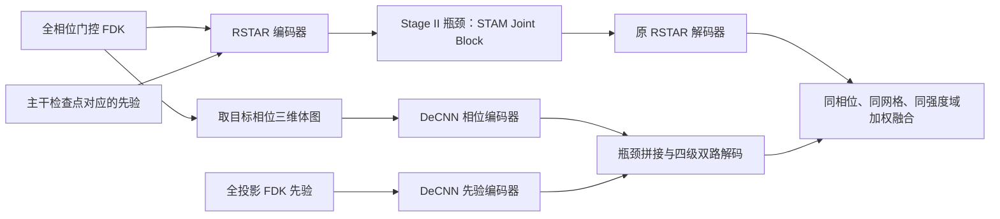

# RSTAR-STAM 联合完整 3D DeCNN 的设计规格

**2026-11-26 · 设计稿 · 组合模型待实现与验证**

以已有猪心 **Stage II RSTAR-STAM** 为主路径，并联 Jiang 等提出的完整 **3D DeCNN**。主路径在 RSTAR 瓶颈使用一个 STAM Joint Block 处理整段相位序列。DeCNN 对每个相位独立编码门控体图和全投影平均体图，经瓶颈拼接、四级双路跳跃连接和解码得到该相位的增强图。两支仅在最终图像域融合。研究问题是：在已经使用 STAM 的条件下，DeCNN 学到的三维先验还能否降低左室边缘误差，同时保住心脏运动幅度？

## 1. 模块职责与数据流

| 部分 | 输入与输出 | 实施边界 |
|---|---|---|
| RSTAR-STAM | 门控序列 $X$ 与按原检查点构造的先验 $A_S$ → 全相位预测 $S$ | 复用现有 Stage II 实现。在 `conv4_3` 残差相加之后、`conv5` 上采样之前调用一次完整 Joint Block，包含空间和时间分支、三个 Adapter 以及输入/输出映射。 |
| 完整 DeCNN | 目标相位门控三维体图 $X_t$ 与全投影先验 $A_D$ → 单相增强三维体图 $D_t$ | 按 DeCNN 图 1 保留两套独立编码器、瓶颈和完整解码器。共享模型权重逐相位运行。DeCNN 直接读原始 FDK 图像。 |
| 输出融合 | 同一中心相位的 $S_t$ 和逆变换后的 $D_t^*$ → 最终输出 $\widehat Y_t$ | 仅增加一个跨动物、相位和体素共用的标量 $\alpha$。支持旁路和离线复用预测。 |

RSTAR-STAM 已能利用先验和跨相位信息。DeCNN 借鉴点在于**将目标相位、全投影先验独立编码，并在每一级恢复分辨率时再次访问两路结构证据**。这可能有助于找回强条纹旁的解剖边缘。平均图也可能把快速运动的心壁拉向平均位置，因此运动保真是保留组合模型的必要判据。输出组合的成功只能支持预测互补，不能单凭此结果推断 STAM 内部特征被 DeCNN 改善。[DeCNN 原文图 1、式（1）](https://doi.org/10.1109/TRPMS.2021.3133510) · [STAM 实施计划](../../../../RSTAR4D/docs/superpowers/plans/2026-11-25-rstar4d-stam-joint-block-implementation.md) · [当前 Stage II 接入点](../../../../RSTAR-STAM/rstar4d/models/official_stage2.py)

## 2. 输入、DeCNN 原结构与输出公式

**两路先验分别追溯。** $X$ 为 `[B,1,T,Z,H,W]`，$A_S,A_D$ 各为 `[B,1,Z,H,W]`，训练监督 $Y$ 与 $X$ 同网格、同相位。RSTAR-STAM 将 $A_S$ 沿时间展开并与 $X$ 拼接为原版双通道输入。其先验以**实际检查点的训练快照**为准。猪心仿真默认 `phase_weighted_fdk`，按各相位视角数加权合成。DeCNN 的主方案使用 `all_views_fdk`，对同次动态扫描的全部混合投影做一次 FDK。两支共享门控 FDK 和扫描来源，但两种先验的数值未必相同。[猪心仿真配置](../../../../RSTAR-STAM/configs/simulation/pig_heart_post_fdk.yaml) · [先验生成代码](../../../../RSTAR-STAM/rstar4d/simulation/pipeline.py)

- 按真实相位标签配对，核对两支的方向、体素间距和原点，使预测处于同一网格，使用相同有效 FOV、裁剪和同步增强。先按动物划分数据，再抽相位与体块。先验只来自该次扫描可用投影，参考体图仅用于监督或评价。
- 若存量数据只保存了一种先验，优先从原始混合投影生成缺少的 $A_D$。同网格且来源经元数据验证为全投影 FDK 时可直接复用。若无法取得全投影先验，可单列“两支共用既有先验”的适配实验，并记录来源。首轮固定主路径的 $A_S$。要把收益归因到独立编码机制时，应另做同先验对照以隔离先验构造差异。

**DeCNN 原生结构。** 输入为两个单通道三维体积 $(X_t,A_D)$，例如恢复第 5 相就只取第 5 相体图和全投影平均体图。两套编码器结构相同、权重独立。各层用 $3^3$ 卷积、BN、ReLU，跳跃层通道为 32、64、128、256，底部每路 512。使用 $2^3$ 最大池化，深层按图使用 0.5 dropout。两组 512 通道在瓶颈拼接，解码器逐级三维上采样并接入两路同尺度跳跃特征。末端 $1^3$ 卷积加 ReLU，直接预测增强体图。四次立体池化需真实连续切片，体块三轴宜取 16 的倍数。补边在输出处裁回，损失排除无效域。未由论文锁定的插值、BN 常数等实现细节在复现时记录。CycN-Net 的二维窗口不进入该模块。

**输出合同。** 记 $g$ 为 DeCNN 支路的固定强度变换，$S_t$ 为 RSTAR-STAM 预测完成原训练归一化逆变换后的结果。支路进入融合前统一到同一线性物理强度域：

$$
D_t^*=g^{-1}\!\left(\operatorname{DeCNN}(g(X_t),g(A_D))\right),\qquad
\widehat Y_t=(1-\alpha)S_t+\alpha D_t^*,\quad 0\leq\alpha\leq1.
$$

猪心 STAM 配方的归一化参数为 scale 0.02、offset 0，实际运行由检查点决定。若物理域含负值，DeCNN 用协议确定的固定平移和正尺度让有效目标范围可由末端 ReLU 表示，保存 $g$、单位、校准与超界规则。推理按相位标签、网格、有效域对齐两支输出。$\alpha=0$ 恢复**该检查点的 RSTAR-STAM**，$\alpha=1$ 恢复同尺度的完整 DeCNN。冻结实验可以先导出并缓存两支预测，直接离线标定和融合。[STAM 训练配方](../../../../RSTAR-STAM/configs/train/pig_stam_frozen.yaml)

## 3. 四条训练路线与参数范围

下表中“STAM 新层”指三个 Adapter 和两端通道映射。“SAM”指 Joint Block 内已有的预训练注意力、归一化和 MLP。首轮优先评价现有 STAM 的增量收益。

| 路线 | RSTAR、STAM 新层、SAM | DeCNN 与 $\alpha$ |
|---|---|---|
| **固定已有 RSTAR-STAM，默认** | 恢复选定的猪心 Stage II 完整 Joint Block 检查点。三部分全部冻结并设为评估模式，固定缓冲区，可缓存预测。 | 用独立三维训练对和同相位 MSE 训练完整 DeCNN。固定两支后，在验证动物上选择一个 $\alpha$。 |
| **从零直接训练 Stage II** | 真正无外部权重的路线随机初始化 RSTAR、STAM 新层及 SAM 形状的参数，并让其参与更新。另可选“任务网络从零＋冻结预训练 SAM”的迁移对照，单独记录外部权重来源。 | DeCNN 从零初始化。用融合损失和 DeCNN 自身 MSE 联合训练。$\alpha$ 可从 0 起步，在更新后投影至 $[0,1]$。 |
| **从零做 Tetris 分阶段训练** | Stage I 在单切片时序上只训练原 RSTAR。Stage II 继承本次运行的平面、时间和输出路径，按 RSTAR 规则初始化新启用的 $Z$ 路径，再装配 Stage II Joint Block。SAM 初始化来源与所选从零或迁移路线一致。 | 有真实三维体块后接入 DeCNN。也可先用独立三维训练对预训练该支路。不得将相位轴当作 $Z$ 轴。 |
| **先冻结后解冻** | 从已有 RSTAR-STAM 恢复，预热时整体固定。到指定更新步后放开 RSTAR 和 STAM 新层，原预训练 SAM 保持冻结。主干、新层可用独立学习率。 | 继承预热段最后一步的 DeCNN 权重、BN 状态与融合系数，再联合微调。 |

**两个“冻结”含义不同。** 现有 `stam.train_policy=frozen` 固定 RSTAR 和预训练 SAM，仍训练 STAM 新层。上表首行则固定**整个已训练的 RSTAR-STAM**。若实验目的改为从原版 Stage II 同时学习 STAM 新层和 DeCNN，则沿用前一种策略并另行标注。训练损失需能穿过 RSTAR 解码器回传到 STAM 新层。不能将该结果当作“固定已有 STAM，加 DeCNN”的直接证据。[现有优化器的参数分组](../../../../RSTAR-STAM/rstar4d/training/trainer.py) · [SAM 与 Adapter 实现](../../../../RSTAR-STAM/rstar4d/models/stam.py)

冻结实验的 DeCNN 保留论文的同相位 MSE。联合实验采用 $L=L_{\rm task}(\widehat Y,Y)+\lambda L_{\rm MSE}(D,g(Y))$，其中 $D$ 为 DeCNN 原始输出，$\lambda>0$ 在验证配置中固定，任务损失沿用选定猪心配方，在其约定强度尺度与有效域计算。这样即使初始 $\alpha=0$，DeCNN 也能通过直接监督获得梯度。带外部预训练 SAM 的路线遵循原项目冻结约定。无外部权重的全随机路线是本组合项目须实现的独立对照。

## 4. 加载、推理与可复现性

1. **已有完整主路径。** 从独立指定的 RSTAR-STAM 扩展检查点恢复 Stage II、model profile、`stam.mode=joint`、架构元数据与全部模型状态。复用 `model_from_checkpoint` 严格加载。核验同一输入上恢复后的主路径输出与该项目原 infer 一致，再挂接 DeCNN。原训练器的 `--init-from-stage2` 用于从原版 Stage II 新装 STAM，会拒绝已带 STAM 的权重。组合实验应有独立的“从已有 RSTAR-STAM 启动”入口。[严格加载路径](../../../../RSTAR-STAM/rstar4d/models/model.py) · [原版初始化校验](../../../../RSTAR-STAM/rstar4d/training/trainer.py)
2. **从零与转段。** 现有 STAM 只在 Stage II 安装，且构造时固定 SAM。无外部权重的联合路线需显式启用随机 SAM 的更新。使用 Tetris 时先迁移原主干，再装配 Joint Block，避免原版严格加载与新增键冲突。按来源记录各组可训练参数，保持已有权重、已学映射和融合系数连续。同段续训恢复原优化器与调度状态。解冻时保留已有组的有效优化状态，为新放开的参数建立对应组，边界转换只执行一次。
3. **空间与显存。** RSTAR-STAM 采用其原 profile 的相位拓扑和 full/tiled 规则，覆盖猪心序列的 10 或 11 个实际相位。DeCNN 可逐相位分批独立运行。按各支空间步幅补边，再裁回共同物理网格。固定滑窗和重叠设置测量整例中心/接缝误差、训练与推理峰值显存、单例端到端耗时。冻结时可分两次推理。联合时保留两条有效梯度路径。
4. **保存。** 记录源检查点路径或可复核标识、SHA-256、STAM 结构与 SAM 来源、DeCNN 架构版本、两路 prior_mode 及生成信息、强度变换、相位标签、动物划分、校准规则与 $\alpha$。冻结且有可用原件时可引用其摘要。参与过更新的全部主干和支路必须可恢复。断点另存当前阶段、参数组、优化器、调度器、混合精度、随机/采样状态及选模记录。验收使用有效的实验检查点，smoke 或资源测试产物只作工程检查。

## 5. 主要实验：DeCNN 加在 STAM 上还有多少收益

首轮用相同猪心门控序列、动物划分、配对标签、有效 FOV 和评价代码。冻结模型后缓存 **RSTAR、RSTAR-STAM、DeCNN** 三份预测，可组成下面四个主对照。明确用模型名记录组别，避免与 STAM 计划原有 A–H 编号混淆。

| 主对照 | 预测 | 主要比较 |
|---|---|---|
| RSTAR | 原版 $R$ | 无两项扩展的起点 |
| RSTAR-STAM | 已选定的 $S$ | 组合模型的直接基线 |
| RSTAR＋DeCNN | $(1-\alpha_R)R+\alpha_R D^*$ | 对 RSTAR 测量加入 DeCNN 的增量 |
| **RSTAR-STAM＋DeCNN** | $(1-\alpha_S)S+\alpha_S D^*$ | **对 RSTAR-STAM 测量已有 STAM 条件下加入 DeCNN 的增量** |

两种组合复用同一份 DeCNN 权重和预测，另报告 DeCNN 单独输出（$\alpha=1$）。比较 STAM 本身时使用主干起点、更新预算相匹配的原版对照。若一个检查点已经联合微调而另一个仅冻结评价，要标明差别。同一训练路线内做配对比较，端到端联合结果与缓存输出的冻结实验分别报告。

**融合系数的选择。** 两种组合在相同验证动物上分别按相同规则标定一个全局系数。搜索包括 0 和 1，以满足预设运动误差容许量为前提，选择动物等权的左室边界 MAE 最低者。并列时取较小值。有配对 ED/ES 标注不足时，只能报告边缘结果并将运动保真标为待验证。锁定权重、两个系数和所有预处理后，在留出动物上各评价一次。若专门比较 STAM 在融合前后的作用，可增报同一 $\alpha$ 的结果。此时两种融合图之差恒为 $(1-\alpha)(S-R)$，该图像差本身不能证明存在模块间协同。

**保留与解释。** 主终点是可信左室标注内、外各两个体素边界带与有效 FOV 交集内的原强度域 MAE。运动指标为舒张末至收缩末的左室容积变化绝对误差（mL），使用真实相位标签、同一固定轮廓提取器及体素间距。先扫描内汇总相位，再动物内汇总扫描，最后动物等权报告配对差、获益动物数与不确定区间。记录缺标、空 ROI、提取失败与有效动物数。骨缘误差、血管/室壁剖面和固定窗口 SSIM 作为辅助结果。[既有左室评价实现](../../../../RSTAR-STAM/rstar4d/evaluation/lv_metrics.py) · [STAM 实验与运动容许量约定](../../../../RSTAR-STAM/docs/superpowers/specs/2026-11-25-rstar4d-stam-joint-block-design.md)

只有组合模型相对 **RSTAR-STAM** 在留出动物上改善边界 MAE，且运动误差满足预先锁定的容许量，才支持在现有 STAM 上保留 DeCNN。$\alpha_S=0$ 表示验证准则选择原主路径。$\alpha_S=1$ 表示选择 DeCNN 单支。若要进一步检验 DeCNN 的平均先验，在相同预算下将其先验路改读 $X_t$ 并重新训练，对照主路径及其 $A_S$ 保持固定。若还要归因到“双路独立编码”，另需在相同两幅输入与相近容量下比较早期融合。

## 6. 工程验收与当前状态

| 验收项 | 判据 |
|---|---|
| 主路径与端点 | 严格恢复一个完整 Stage II Joint Block 检查点。相同评估模式、输入和滑窗下，旁路或 $\alpha=0$ 复现该 RSTAR-STAM 的输出。$\alpha=1$ 复现逆变换后的 DeCNN。用确定性 FP32 检查，中间权重的在线与缓存融合在数值容差内一致。 |
| 原生 DeCNN | 固定 $X_t,A_D$、改变其他相位的输入，仅检验 DeCNN 单支时 $D_t$ 不变。核对两套编码器权重独立、一次瓶颈拼接、四级双路跳连、三维网格和非负图像头。 |
| 冻结和训练 | 首轮两次有效更新前后，整个 RSTAR-STAM 参数和缓冲区逐张量相等，DeCNN 有效更新。联合模式按配置检查 RSTAR、STAM Adapter/映射及 DeCNN 梯度，预训练 SAM 保持固定。全随机对照另核验 SAM 可更新且无外部初始化依赖。 |
| 数据与转段 | 核验两路先验来源、强度往返、物理网格、真实相位标签及有效域。Stage I 只运行 RSTAR，Stage II 使用真实连续层。冻结转联合与断点重载均保留已有两个模型和 $\alpha$。 |
| 科研验收 | 留出动物的四组结果、DeCNN 单支端点、运动指标有效样本量与整序列成本齐全。重点报告“RSTAR-STAM＋DeCNN 减 RSTAR-STAM”的配对误差差值。 |

本次已核对本地 RSTAR-STAM 的瓶颈接线、加载逻辑、冻结策略、猪心先验生成方式和左室评价入口，并对照 DeCNN 论文图 1。以上是组合规格。尚未实现组合训练或获得联合模型的留出动物结果。
